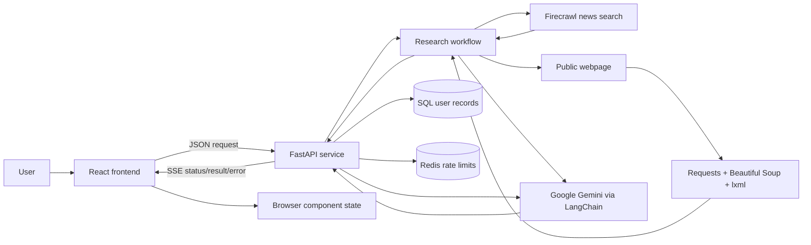
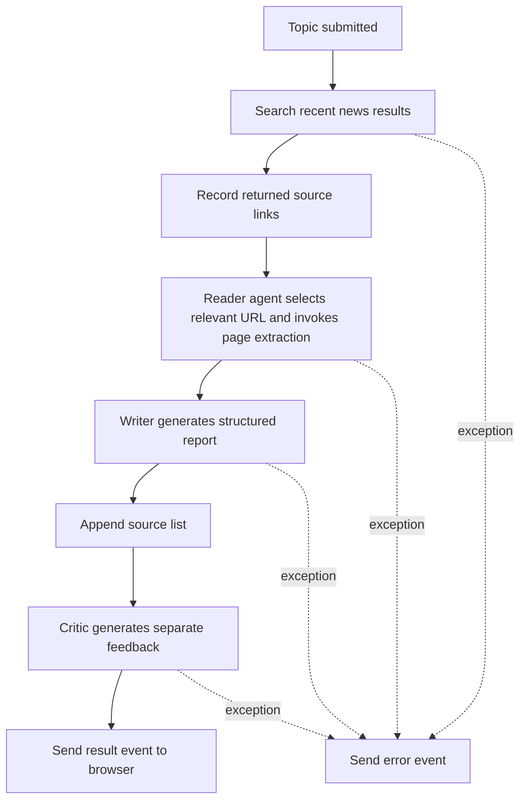
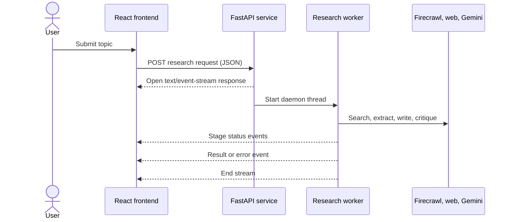

# ResearchMind

## Project Report and Technical Documentation

## 1. Cover Page

| Report field | Details |
|---|---|
| Project title | ResearchMind |
| Subtitle | AI-assisted web research, report generation, critique, and report editing |
| Domain / industry | Research productivity; information discovery and synthesis |
| Prepared by | Ultriti-Tech (organization named as backend package author) |
| Institution / organization | Ultriti-Tech; no separate academic institution is specified in the repository |
| Project version | Backend package `0.1.0`; frontend package `0.0.0`; no shared product release version is defined |
| Report date | 2026-11-06 |

> **Scope note:** This report documents the implementation present in the repository as inspected for this report. It distinguishes implemented behavior from limitations and future work. Credentials and secret values are deliberately excluded.

## Table of Contents

1. [Cover Page](#1-cover-page)
2. [Abstract / Executive Summary](#2-abstract--executive-summary)
3. [Introduction](#3-introduction)
4. [Industry Use Cases & Applications](#4-industry-use-cases--applications)
5. [System Requirements](#5-system-requirements)
6. [Technology Stack](#6-technology-stack)
7. [Technologies Used – Detailed Explanation](#7-technologies-used--detailed-explanation)
8. [System Architecture](#8-system-architecture)
9. [Module Description](#9-module-description)
10. [User Roles & Responsibilities](#10-user-roles--responsibilities)
11. [Application Workflow](#11-application-workflow)
12. [Database Design](#12-database-design)
13. [API Documentation](#13-api-documentation)
14. [Screenshots & User Interface Documentation](#14-screenshots--user-interface-documentation)
15. [Implementation Details](#15-implementation-details)
16. [Testing & Validation](#16-testing--validation)
17. [Results & Discussion](#17-results--discussion)
18. [Future Enhancements](#18-future-enhancements)
19. [Conclusion](#19-conclusion)
20. [References](#20-references)

## 2. Abstract / Executive Summary

ResearchMind is a browser-based AI research assistant. A user enters a topic and the application returns a structured Markdown report, source links, and a separate critique. The user can then inspect the report and review, ask questions grounded in the report, make direct edits, or request suggested edits that can be accepted or rejected before the report changes.

The frontend is a React application. A Python FastAPI service coordinates research and model-provider operations. The active research workflow uses Firecrawl for news search, a webpage extraction tool, and Google Gemini through LangChain. Pipeline progress is streamed to the browser as Server-Sent Events (SSE). Completed reports, critiques, and sources are saved per user; conversations are not persisted.

The project addresses the effort involved in collecting and organizing initial research material. Its expected benefit is a faster first draft and a convenient human-review workflow; the repository contains no user study or measured productivity impact. Generated reports are not guaranteed to be complete or accurate and should be checked against their linked sources. The current implementation is a working prototype, not a fully tested production service.

## 3. Introduction

### 3.1 Background and context

Research work often involves several related activities: discovering current information, choosing relevant sources, extracting useful content, writing a synthesis, reviewing the draft, and revising it. ResearchMind brings these activities into one browser workspace to support an initial research pass and report refinement.

### 3.2 Industry overview

AI-assisted research and writing tools can accelerate information discovery and synthesis. Their practical value depends on the quality and freshness of the retrieved material, the accuracy of generated text, and the user's ability to verify sources. ResearchMind includes source links and a separate review interface, but the code does not independently establish the factual correctness of generated claims.

### 3.3 Problem statement

The project targets the time and context switching involved in turning an open-ended topic into a structured first draft. It also provides a way to ask follow-up questions about that draft and to review proposed revisions without silently applying them.

### 3.4 Motivation

- Provide a single interface for a topic, report, review, and follow-up assistant.
- Make longer-running work visible with progress indicators.
- Keep source links available for human inspection.
- Preserve user control over report editing and AI-suggested changes.

### 3.5 Objectives

1. Accept a research topic and prepare an organized report.
2. Include a list of source links returned by the research process.
3. Display a separate critique of the generated report.
4. Support report-focused question answering.
5. Enable direct editing and export of report text.
6. Present proposed text changes for user approval.

### 3.6 Scope

The implemented scope includes the research workflow and a basic account workflow:

- Home and About pages.
- Topic entry and suggested topic buttons.
- Four visible progress stages: search, reading, writing, and critique.
- A Markdown report with an appended source list.
- A separate review/feedback view.
- Report copy, download, and direct edit actions.
- Report-focused assistant chat.
- AI-suggested report edits with accept/reject controls.
- Account registration/login, JWT-based authentication, and authenticated profile lookup.
- Selected IP- and account-based rate limits backed by Redis.

### 3.7 Limitations

- User accounts and generated reports are stored in the configured SQL database; reports are associated with their owning user. Chat conversations are not durably stored; account deletion is currently a placeholder.
- The repository does not include a database migration or table-creation command.
- Research, chat, and edit features depend on configured external services and network availability.
- Search results and page text are deliberately bounded in the current implementation.
- Source relevance and report factuality are not measured by an evaluation suite.
- No automated backend test suite is declared in the repository.
- No complete production deployment, monitoring, or operational configuration is included.
- A Groq model client is configured in source but is not used by the active research/chat/edit routes.

## 4. Industry Use Cases & Applications

The following are plausible applications based on implemented functionality. They are not claims of customer deployments or validated business results.

| Target user / stakeholder | Example scenario | Potential value | Required human review |
|---|---|---|---|
| Student or educator | Build a starting overview of a topic and inspect source links for further reading | Organizes early exploration and produces a draft to discuss | Verify claims, source quality, and citation suitability |
| Research or market analyst | Prepare a first-pass summary of public reporting around a trend | Reduces initial collection and drafting work | Compare coverage with primary and licensed sources |
| Product or strategy team | Develop a background brief before a planning discussion | Gives a team a shared starting document | Confirm dates, market details, and decision-critical claims |
| Writer or communications professional | Assemble a draft backgrounder from public information | Helps structure an initial narrative | Editorial review and fact-checking before distribution |
| General knowledge worker | Ask follow-up questions about a generated topic report | Keeps exploration connected to the report | Treat answers as assistance, not independent evidence |

Potential adoption is most appropriate for low-risk, human-reviewed research preparation. The repository does not implement enterprise identity, confidential-data handling controls, regulated-domain safeguards, usage governance, or retention policy. These areas require review before broader organizational adoption.

## 5. System Requirements

### 5.1 Hardware requirements

The repository does not specify minimum CPU, memory, or disk requirements. Use requires a device capable of running a modern browser. Development additionally requires the Python and Node.js runtimes. Model inference is configured through hosted services; no local model hardware requirement is declared.

### 5.2 Software requirements

| Requirement | Evidence / notes |
|---|---|
| Python | `.python-version` specifies `3.11`; `pyproject.toml` requires `>=3.11` |
| Node.js and npm | Required for frontend npm scripts; no exact Node.js version is declared |
| Modern web browser | Required to use the React frontend; no formal browser support matrix is present |
| Frontend packages | Declared in `frontend/package.json` and locked by `frontend/package-lock.json` |
| Backend packages | Listed in `backend/requirements.txt`; `backend/pyproject.toml` currently has an empty `dependencies` list |
| Google Gemini service | Active model integration used for report-related AI capabilities; requires configured credentials |
| Firecrawl service | Active news search integration; requires configured credentials |
| Groq service | Client and dependency are present, but no active route flow uses the configured Groq model |
| SQL database | Required for account registration and lookup; connection is configured with `DATABASE_URL` |
| Upstash Redis | Required for the configured rate limits; connection is initialized from environment variables |

Environment variable **names** referenced in source/configuration include `FIRECRAWL_API_KEY`, `GOOGLE_API_KEY`, `GROQ_API_KEY`, `DATABASE_URL`, `JWT_SECRET_KEY`, `FRONTEND_URL`, `FRONTEND_URL_2`, and `VITE_BASE_URL`. Redis is initialized with `Redis.from_env()` and requires the provider's expected environment variables. Their values are private and are not included here.

### 5.3 Functional requirements

1. Submit a topic and request research.
2. Receive progress events while research is being processed.
3. View the report and its separate critique.
4. Inspect the report's source links.
5. Ask a question about the current report.
6. Request an edit to the report and review the proposed changes.
7. Accept or reject the proposed edit.
8. Edit report text directly, copy it, or download it as Markdown.
9. Navigate between the Home and About pages.
10. Register or log in and use authenticated API routes.

### 5.4 Non-functional requirements and implementation evidence

| Attribute | Current evidence / limitation |
|---|---|
| Usability | Dark theme, responsive layout, progress indicator, Markdown reading, and assistant interface are implemented |
| Interoperability | Browser and service communicate using JSON and an SSE research stream |
| Configuration | Frontend base URL and service credentials are configured through environment variables |
| Input validation | Pydantic validates request structures; edit requests have specific length, size, and filename validation |
| Security | JWT authentication and selected Redis-backed rate limits are implemented; roles, shared-report access, and production hardening remain incomplete |
| Performance | No latency targets, load tests, or benchmarks are declared |
| Reliability | Provider failures are surfaced, but retries, cancellation, and durable background jobs are not implemented |
| Accessibility | Some labels and live regions exist; no formal accessibility audit is documented |

## 6. Technology Stack

| Category | Technology | Purpose |
|---|---|---|
| Frontend | React 19, JavaScript/JSX | Build interactive browser UI |
| Frontend tooling | Vite 8 | Development server and production bundling |
| Routing | React Router 7 | Home and About navigation |
| Styling | Tailwind CSS 4, custom CSS | Utility styling, theme tokens, responsive workspace layout |
| Markdown UI | `react-markdown`, `remark-gfm`, `@tailwindcss/typography` | Render reports, feedback, and chat Markdown |
| Backend | Python 3.11+, FastAPI | HTTP application and request handling |
| ASGI server | Uvicorn | Backend development/runtime server |
| Data validation | Pydantic | Request models and edit input validation |
| AI orchestration | LangChain, LangChain Core, LangGraph package | Model wrappers, prompts, tools, agents, and output parsing; no direct LangGraph graph is constructed in the inspected flow |
| AI/ML provider | Google Gemini via `langchain-google-genai` | Active research writing, critique, report Q&A, and edit proposals |
| Additional AI integration | Groq via `langchain-groq` | Client configured in source, unused by active request paths |
| Research search | Firecrawl Python SDK | Search news results for a topic |
| Page extraction | Requests, Beautiful Soup 4, lxml | Fetch HTML and extract readable text |
| Configuration | `python-dotenv` | Load environment variables from `.env` files |
| API communication | JSON over HTTP; Server-Sent Events | Frontend/service communication and streaming research progress |
| Database | SQLAlchemy, configured SQL database, psycopg driver | Persists user accounts and report records; chat conversations are not persisted |
| Rate limiting | Upstash Redis | Supports selected IP- and account-based request limits |
| Deployment | No complete deployment platform/configuration declared | A Netlify origin appears in CORS configuration, but this alone does not establish a deployed service |
| Development tools | npm, ESLint, Vite, Python `compileall`, `uv_build` declaration | Frontend scripts, linting, build, Python package build metadata/syntax checks |

## 7. Technologies Used – Detailed Explanation

### 7.1 React and JavaScript

**What it is:** React is a JavaScript library for building component-based user interfaces.

**Why it is used:** The project has multiple interactive areas—research entry, progress, report/review display, and chat—that benefit from component composition and local UI state.

**How it is used:** React components render the Home and About pages and shared controls. Component state holds the current topic, step statuses, generated result, errors, messages, pending edit, and presentation controls.

**Responsibilities:** Render user-visible state, collect input, invoke the frontend API helper, and update the displayed report after accepted/direct edits.

**Advantages:** Component reuse, declarative rendering, and an established ecosystem.

**Limitations:** Current chat conversation state is not persisted across reloads; saved report records are available through the report-history route. No frontend test framework is declared.

### 7.2 Vite

**What it is:** Vite is a frontend development server and build tool.

**Why it is used:** It provides a fast local development loop and produces deployable static frontend assets.

**How it is used:** `frontend/vite.config.js` enables the React and Tailwind CSS Vite plugins. `frontend/package.json` defines `dev`, `build`, `lint`, and `preview` scripts.

**Responsibilities:** Development serving, frontend transformation, and production bundling.

**Advantages:** Fast startup and build pipeline integrated with the frontend ecosystem.

**Limitations:** A production hosting platform and deployment pipeline are not configured in the inspected repository.

### 7.3 Tailwind CSS and custom CSS

**What they are:** Tailwind CSS is a utility-first styling system. Custom CSS supplies shared styles and layout rules.

**Why they are used:** Utility classes support rapid component styling; CSS variables centralize theme values and custom workspace layout behavior.

**How they are used:** Tailwind CSS is loaded through the Vite plugin. `frontend/src/App.css` declares dark-theme colors, spacing/layout rules, scrollbar styling, and animations. Component classes compose UI styles.

**Responsibilities:** Theme, report workspace, responsive behavior, interaction states, and typography.

**Advantages:** Consistent reusable tokens and quick layout changes.

**Limitations:** Utility-heavy markup can become dense; responsive behavior must be validated at actual viewport sizes.

### 7.4 React Router

**What it is:** A client-side routing library for React.

**Why it is used:** The frontend exposes Home and About pages without a full-page route reload.

**How it is used:** The application declares `/` and `/about`; the current location also determines whether the home workspace uses its viewport-constrained desktop layout.

**Responsibilities:** Navigation and route rendering.

**Limitations:** Server-side fallback configuration for production hosting is not documented.

### 7.5 FastAPI, Uvicorn, and Pydantic

**What they are:** FastAPI is a Python web framework, Uvicorn an ASGI server, and Pydantic a data validation/model library.

**Why they are used:** They provide typed request validation, HTTP routing, standard error responses, CORS support, and streaming-response support.

**How they are used:** `backend/main.py` creates the FastAPI application, configures CORS, and mounts the versioned API router. Route request bodies use Pydantic models. Research returns a streaming response; chat and edit operations return JSON.

**Responsibilities:** Accept frontend requests, validate request data, invoke service functions, and return streamed or JSON results.

**Advantages:** Typed request models, documented route patterns, and straightforward ASGI integration.

**Limitations:** Basic JWT authentication exists, but there is no role-based authorization or report ownership. Dependency metadata is inconsistent: `requirements.txt` lists dependencies while `pyproject.toml` declares none.

### 7.6 LangChain and LangGraph package

**What they are:** LangChain provides model abstractions, prompts, tools, chains, and agent helpers. LangGraph is a related package for graph-based agent workflows.

**Why they are used:** LangChain connects the configured model to prompts, structured outputs, tools, and agent invocations.

**How they are used:** The code uses prompt templates, `StrOutputParser`, `create_agent`, model `.invoke`, and structured output for patches. The research pipeline is sequential Python orchestration; although `langgraph` is listed as a dependency, no direct graph workflow construction is present in the inspected pipeline.

**Responsibilities:** Prompt/model composition, reader-agent tool use, writer/critic chains, and structured patch output.

**Advantages:** Reusable model abstractions and tool/prompt composition.

**Limitations:** Provider behavior, generated output, cost, and latency are external; adding a library dependency does not mean every feature of that library is used.

### 7.7 Google Gemini integration

**What it is:** A hosted generative model accessed through the LangChain Google Generative AI adapter.

**Why it is used:** It provides the active language model used for report generation and related assistant capabilities.

**How it is used:** The source configures `ChatGoogleGenerativeAI` with model ID `gemini-3.5-flash-lite` and temperature `0`. It is used by the reader agent, writer and critic chains, report Q&A, and structured edit generation.

**Responsibilities:** Generate report prose, report critique, report-grounded answers, and proposed textual changes.

**Advantages:** Hosted inference avoids requiring the application operator to serve a model locally.

**Limitations:** The application depends on provider access, credentials, usage limits, and provider data policies. Model output may be inaccurate or incomplete; no formal model evaluation is present.

### 7.8 Groq integration

**What it is:** A hosted model-provider integration through `langchain-groq`.

**How it is used:** A `ChatGroq` client is configured with model ID `openai/gpt-oss-20b` and temperature `0`.

**Current status:** The configured client is not used in the active routes or research pipeline inspected for this report. It should not be described as a functioning fallback or user-selectable provider.

### 7.9 Firecrawl

**What it is:** An external web research/search service with a Python SDK.

**How it is used:** The backend requests news sources for a topic with a limit of five results and normalizes returned title, URL, snippet, source, and date fields.

**Responsibilities:** Provide candidate news results and URLs for report research.

**Advantages:** Externalizes web search instead of maintaining a search index in the project.

**Limitations:** Requires credentials and network access. Result availability and relevance depend on the provider. The project does not independently rank/evaluate source quality.

### 7.10 Requests, Beautiful Soup, and lxml

**What they are:** Requests is an HTTP client; Beautiful Soup parses HTML; lxml is the selected parser backend.

**How they are used:** The webpage tool fetches a URL with a 20-second timeout, parses the response, removes common non-content elements (script, style, navigation, footer, and header), extracts text, and truncates it to 3,000 characters.

**Responsibilities:** Retrieve and extract text from a selected public webpage.

**Advantages:** Small, established components for simple HTTP retrieval and HTML extraction.

**Limitations:** Websites may block requests, require JavaScript, or provide incomplete/nonrepresentative text. Extraction is bounded and does not establish factual correctness.

### 7.11 SSE and browser Fetch streams

**What they are:** Server-Sent Events is a text event-stream format; Fetch exposes the response body as a readable stream.

**How they are used:** The backend emits JSON in `data:` SSE records separated by blank lines. The frontend reads chunks, buffers incomplete records, parses complete JSON events, and updates progress/result/error state.

**Responsibilities:** Provide progressive status updates for the longer research operation.

**Advantages:** Progress can be delivered over an HTTP response without adding a separate WebSocket protocol.

**Limitations:** The frontend parser handles the event format used by this backend rather than a general-purpose SSE client. The current worker uses a daemon thread and in-memory queue; requests are not durable jobs and do not provide explicit cancellation.

### 7.12 Markdown libraries

`react-markdown` renders Markdown content in the report and chat. `remark-gfm` enables GitHub-Flavored Markdown features. `@tailwindcss/typography` supplies prose styling. These packages affect content presentation, not fact checking or report generation.

### 7.13 Account database and report storage

SQLAlchemy and a configured SQL database store user account records, credit balances, and generated report records (including critique and sources). The repository has no database migration or table-creation command. Chat conversations are not durably stored by the application.

## 8. System Architecture

### 8.1 Overall architecture

The application has a React/Vite frontend and a Python/FastAPI service. The frontend sends account, research, report-history, report-chat, and edit requests to the service. The service uses a configured SQL database for account, credit, and report records, Upstash Redis for selected rate limits, and Firecrawl and hosted language-model integrations for its active AI-assisted features. Research progress is streamed to the frontend. The browser holds the active report and conversation state; saved reports can be loaded from the database, while chats are not persisted.

### 8.2 Architecture diagram



### 8.3 Frontend/backend communication

- The frontend reads the backend base URL from `VITE_BASE_URL`.
- JSON is sent for research, report chat, and edit requests.
- The research route returns `text/event-stream` with `status`, `result`, or `error` events.
- The chat and edit routes return JSON.
- `main.py` configures CORS for `http://localhost:5173`, a static Netlify origin, and optional `FRONTEND_URL` and `FRONTEND_URL_2` environment values. Methods and headers are configured as wildcards.

### 8.4 AI and research processing

The active research process consists of a news search, a reader-agent invocation that can use the webpage extraction tool, report generation, and critique generation. The report's source section is built from the returned URLs. Report Q&A and edit proposal generation use the configured Gemini model as well.

### 8.5 Database interaction

The backend uses SQLAlchemy to load and store user account, credit, and report records in the configured SQL database. Redis is used by the selected rate-limit dependencies. The active browser session contains conversation state; saved reports can be retrieved from the user's report history.

### 8.6 External services

- Firecrawl: news search.
- Google Gemini: text generation, critique, report chat, and edit proposals.
- Public web pages: retrieved by the extraction tool.
- Groq: configured client only; unused in active flows.

## 9. Module Description

| Module | Purpose | Internal behavior | Input → output | Technologies / dependencies |
|---|---|---|---|---|
| Frontend application shell | Mount app, navigation, and route-specific layout | Renders Navbar and Home/About route; uses current path to apply workspace layout | Browser path → page | React, React Router |
| Home research workspace | Collect topic, launch research, show progress and result | Tracks topic, stage statuses, request state, error, and result | Topic → progress, report, feedback | React, API helper, Sidebar, ReportView, ChatBot |
| Frontend API helper | Communicate with backend | Sends JSON requests; parses research stream events; validates response shape for chat/edit | User data → callbacks / JSON | Fetch API, `VITE_BASE_URL` |
| Pipeline progress UI | Display stage and completion state | Computes status label and progress percentage from four stage states | Stage state → progress bar | React, `steps.js` |
| Report view | Display, review, and export report | Switches report/review tabs; direct edit state; clipboard copy; Markdown Blob download | Report and feedback → rendered content / file | React Markdown, remark-gfm, browser APIs |
| Chat assistant | Handle report questions and edit suggestions | Maintains message/error state; sends query or edit request; presents changes for acceptance/rejection | Report + message → answer/proposal | React, API helper, React Markdown |
| FastAPI application | Configure service and mount versioned API router | Loads dotenv values, configures CORS, includes router under `/api/v1` | HTTP request → HTTP response | FastAPI, `python-dotenv` |
| Research route | Execute research request and stream events | Starts a daemon worker thread; uses a queue for progress and terminal result/error events | Research request → SSE events | FastAPI, Python threading/queue, pipeline |
| Chat agent route | Answer questions against supplied report | Requires a nonempty message list whose final message is from the user; sends report and conversation to Gemini | Topic, report, messages → `{answer}` | FastAPI, Pydantic, LangChain messages, Gemini |
| Edit route | Generate and apply report patch | Requests a structured patch, applies it, checks Python syntax for `.py` filenames, returns updated text and diff | Code, instruction, filename → edit result | FastAPI, Pydantic, Gemini, patcher |
| Research pipeline | Coordinate search, reading, writing, critique | Calls four sequential stages; records sources; appends source links; emits optional stage callbacks | Topic → report, feedback, sources | Search tools, agents, Gemini chains |
| Agent/model configuration | Configure model clients, prompts, and agents | Defines Gemini and Groq clients; reader/search agent constructors; writer/critic prompt chains; Q&A helper | Prompt/messages → model result | LangChain, `langchain-google-genai`, `langchain-groq` |
| Research and edit tools | Search, extract, and generate patch suggestions | Normalizes Firecrawl news results; fetches and extracts webpage text; produces structured edit patch | Query/URL/code+instruction → results/text/patch | Firecrawl, Requests, Beautiful Soup, lxml, Gemini |
| Patch application | Safely locate and apply proposed changes | Matches old text with whitespace flexibility and optional context; rejects absent/ambiguous/overlapping changes; applies replacements in reverse order | Original text + patch → updated text + unified diff | Python `re`, `difflib` |
| Schemas | Validate request/result structures | Pydantic request models and TypedDict search result shapes | JSON/body values → validated objects | Pydantic, Python typing |

### 9.1 Frontend components

| Component / file | Responsibility |
|---|---|
| `frontend/src/main.jsx` | Creates the React root and renders the app in `StrictMode` |
| `frontend/src/App.jsx` | Router, shared app shell, navigation, and route-specific workspace class |
| `frontend/src/Components/Navbar.jsx` | ResearchMind brand link and Home/About navigation |
| `frontend/src/Pages/HomePage/HomePage.jsx` | Topic form, pipeline run, status, error, and result handling |
| `frontend/src/Components/Sidebar.jsx` | Four-step research progress display |
| `frontend/src/Components/ReportView.jsx` | Report/review tabs, edit, copy, download, Markdown rendering |
| `frontend/src/Components/ChatBot.jsx` | Report Q&A, edit assistant mode, proposed change review |
| `frontend/src/Pages/AboutPage/AboutPage.jsx` | Product purpose, objectives, audience, technology overview, limitations |
| `frontend/src/api.js` | Research streaming, report Q&A, and edit calls |
| `frontend/src/steps.js` | Four stage identifiers, titles, and descriptions |
| `frontend/src/App.css` | Theme, responsive workspace layout, scrollbar and animation rules |

### 9.2 Backend modules

| File | Responsibility |
|---|---|
| `backend/main.py` | FastAPI application and CORS setup |
| `backend/src/api/v1/routes.py` | Combines user, auth, research, and chat-agent routers |
| `backend/src/api/v1/Routes/Auth.py` | Account registration and login |
| `backend/src/api/v1/Routes/User.py` | Authenticated account lookup; account deletion route is a placeholder |
| `backend/src/api/v1/Routes/Research.py` | Research endpoint and SSE response |
| `backend/src/api/v1/Routes/ChatAgent.py` | Report Q&A and edit endpoints |
| `backend/src/dependencies/user.py` | Resolves the current user from a JWT cookie or bearer token |
| `backend/src/core/rate_limiting.py` | IP- and account-based Redis rate-limit dependencies |
| `backend/src/models/user.py` | SQLAlchemy account model |
| `backend/src/db/` | SQL database session and Redis client setup |
| `backend/src/dependencies/pipeline.py` | Sequential research processing and source formatting |
| `backend/src/dependencies/agents.py` | Model clients, agents, and writer/critic chains |
| `backend/src/dependencies/tools.py` | Firecrawl search, page extraction, AI patch generation |
| `backend/src/dependencies/patcher.py` | Patch matching, validation, replacement, diff creation |
| `backend/src/schema/SchemaModel.py` | Research/chat models and search result types |
| `backend/src/schema/ChatAgent.py` | Patch and edit request models with validators |

## 10. User Roles & Responsibilities

### 10.1 Application user roles

The app now has registered users and authenticated requests, but does not define application roles.

| Role | Permissions / available functions | Restrictions |
|---|---|---|
| Registered user | Sign in and access authenticated research, report history, report chat/edit, and profile routes | No role restrictions or persistent chat history |
| Anonymous visitor | Register or log in; access routes explicitly left public, including IP-limited registration/login | Cannot call account-protected routes without a valid token |
| AI assistant | Product capability that responds to questions or creates an edit proposal | Not an authenticated user role; output is not authoritative and requires user review |

### 10.2 Development team responsibilities

`backend/pyproject.toml` names Ultriti-Tech as the package author. The repository does not specify individual team members or a formal responsibility matrix. A production team would need to own credential handling, provider agreements, deployment, access controls, testing, monitoring, and data-retention decisions.

## 11. Application Workflow

### 11.1 User interaction flow

1. User opens the Home page.
2. User enters a research topic or selects a suggested topic.
3. User starts research and observes stage progress.
4. The workspace displays the report and separate critique after completion.
5. User reads source links, switches tabs, edits, copies, or downloads.
6. User can ask a question in the assistant or switch to edit-assistant mode.
7. For an edit proposal, the user reviews the changes and accepts or rejects them.

### 11.2 Backend processing flow



The current search request asks Firecrawl for news with a limit of five. Search results are serialized for the reader prompt; the reader input uses up to the first 3,000 characters of serialized results. The page extraction tool limits extracted text to 3,000 characters.

### 11.3 API request/response sequence



### 11.4 Data processing flow

- Topic is sent from browser to the research route.
- Search results are normalized into article metadata.
- A reader agent is asked to select a relevant URL and use the extraction tool.
- Search result text and extracted page content are provided to the writer chain.
- Source URLs are appended to the report as Markdown links.
- The critic chain evaluates the finished report and returns separate feedback.
- The report and feedback are held in frontend state for display and follow-up.

### 11.5 Authentication and authorization

Registration and login create a JWT associated with the user ID. The backend sets an HttpOnly cookie and returns the token in the response; the frontend also sends it in an `Authorization: Bearer` header. The shared `CurrentUser` dependency accepts either the cookie or bearer token, validates the JWT, loads the account, and rejects missing/invalid credentials with HTTP 401 or inactive accounts with HTTP 403. Research records are associated with their owner, and history queries filter by the authenticated user. CORS remains a browser-origin policy, not an identity mechanism.

## 12. Database Design

### 12.1 Database technology

SQLAlchemy connects to the configured SQL database using `DATABASE_URL`; the requirements include the psycopg PostgreSQL driver. The `users` table model stores account identity and status fields, including email, username, password hash, active status, and timestamps. The `credits` table stores a unique credit account per user, with balance and reserved-credit fields. Registration grants 50 credits; each research run reserves 20, refunds the charge on pipeline failure, and retains it on success. No migration or automatic table-creation command was found in the repository, so both tables must be provisioned separately.

### 12.2 Persistence behavior

User account records, credit balances, and completed research records are stored in the configured SQL database. A report record includes its title/topic, generated report, critique, sources, and timestamps. Current chat messages and pending edits remain in frontend component state and are not saved as durable server-side records. Saved reports are available from the history route after a page refresh.

### 12.3 In-memory request and result structures

| Structure | Important fields | Purpose |
|---|---|---|
| Research request | `topic: string` | Topic submitted to research |
| Chat message | `role: "user" \| "assistant"`, `content: string` | Conversation context |
| Report chat request | `topic`, `report`, `messages` | Question answering about report |
| News article | `title`, `url`, `snippet`, `source`, `date` | Normalized search result metadata |
| Search result | `query`, `count`, `articles` | Search operation output |
| Research result event | `type`, `report`, `feedback`, `sources`, `credits_balance`, `credits_reserved`, `report_id` | Completed research result, saved report identifier, and account credit state |
| Edit request | `code`, `instruction`, `file_name` | Proposed report edit input |
| Patch change | `old_text`, `new_text`, optional contexts, `reason` | A structured text replacement |

Report records include the owning user ID; chat messages and conversation history are not persisted.

## 13. API Documentation

All routes below are mounted below the `/api/v1` prefix. Authentication-protected routes require a valid JWT in the `access_token` cookie or an `Authorization: Bearer` header. Error responses produced by FastAPI use its standard JSON `detail` shape unless noted as an SSE event.

### 13.1 Account and user routes

| Method | Route | Authentication | Behavior |
|---|---|---|---|
| POST | `/api/v1/auth/register` | Public; IP rate limited | Create an account with 50 credits and return a JWT, user details, and balance. |
| POST | `/api/v1/auth/login` | Public; IP rate limited | Validate credentials and return a JWT, user details, and current balance. |
| POST | `/api/v1/auth/logout` | Public; IP rate limited | Clear the auth cookie; the client must also remove a locally stored bearer token. |
| GET | `/api/v1/users/getUser` | Required | Return the current user's account details and credit balance. |
| GET | `/api/v1/research/history` | Required | Return the current user's saved reports with report content, critique, status, and timestamps, newest first. |
| GET | `/api/v1/research/history/{report_id}` | Required | Return one saved report, including sources, only when it belongs to the authenticated user. |
| DELETE | `/api/v1/users/account` | Required | Placeholder response only; it does not delete the account. |

### 13.2 `POST /api/v1/research/`

**Purpose:** Run research and stream progress/result/error events.

**Authentication and limit:** Requires an authenticated account and is limited to one request per account per hour.

**Credits:** A request reserves 20 credits before starting the pipeline. A successful result retains the charge; a failed pipeline refunds it. The Home page displays the balance returned by `/api/v1/users/getUser` and updates it from the `credits_balance` value in the result event.

**Request body:**

```json
{
  "topic": "Recent advances in quantum computing"
}
```

The body is validated by `ResearchReq`, which declares `topic` as a string without an additional length constraint.

**Response:** `text/event-stream`. Each event is a `data:` line containing JSON and events are separated by a blank line.

Status event:

```json
{
  "type": "status",
  "step": "search",
  "status": "running"
}
```

The `step` values emitted by the pipeline are `search`, `read`, `write`, and `critic`. Status values include `running` and `done`.

Result event:

```json
{
  "type": "result",
  "report": "Markdown report text",
  "feedback": "Critique text",
  "credits_balance": 30,
  "credits_reserved": 20,
  "sources": [
    {
      "title": "Source title",
      "url": "https://example.com/article"
    }
  ]
}
```

Error event:

```json
{
  "type": "error",
  "step": "read",
  "message": "Error message"
}
```

The exact error message is derived from the caught exception. The stream response sets no-cache and proxy-buffering headers.

### 13.3 `POST /api/v1/chatagent/`

**Purpose:** Answer a user question using the supplied topic, report, and conversation.

**Authentication and limit:** Requires an authenticated account and uses an account-based Redis token-bucket limit.

**Request body:**

```json
{
  "topic": "Research topic",
  "report": "Report text",
  "messages": [
    {
      "role": "user",
      "content": "What does the report say about the main limitation?"
    }
  ]
}
```

Allowed message roles are `user` and `assistant`.

**Response body:**

```json
{
  "answer": "Answer based on the provided report"
}
```

**Validation/error behavior:** HTTP 400 is returned if `messages` is empty or the last message is not from the user. The route has `include_in_schema=False`, so it is intentionally omitted from the generated OpenAPI schema even though it remains callable.

### 13.4 `POST /api/v1/chatagent/editchat`

**Purpose:** Generate a structured text patch, apply it to the supplied content, and return the updated content and diff.

**Authentication and limit:** Requires an authenticated account and uses an account-based Redis token-bucket limit.

**Request body:**

```json
{
  "code": "# Existing report text",
  "instruction": "Add a concise summary",
  "file_name": "research-report.md"
}
```

**Success response:**

```json
{
  "success": true,
  "explanation": "Reason for the proposed edit",
  "changes": [
    {
      "old_text": "Existing exact text",
      "new_text": "Replacement text",
      "before_context": null,
      "after_context": null,
      "reason": "Clarifies the report"
    }
  ],
  "updated_code": "Updated report text",
  "diff": "--- original\n+++ updated\n..."
}
```

If no changes are generated, the route returns `{"success": false, "message": ...}`.

**Request validation and error behavior:**

- `code` is limited to 1 MiB by UTF-8 encoded size.
- `instruction` must be 1–4,000 characters and nonblank after trimming.
- `file_name` must be a basename, contain no path separators/control characters, and use one of `.py`, `.js`, `.ts`, `.txt`, or `.md`.
- Patch target not found, ambiguous target, overlapping replacements, invalid model patch input, or invalid Python syntax returns HTTP 422 for the handled `ValueError`/`SyntaxError` cases.
- Python syntax is checked only when the submitted filename has a `.py` extension.
- Unexpected edit-generation failures are logged and returned as HTTP 502 with a generic client detail.

### 13.5 CORS and authentication

The backend permits configured frontend origins, including `http://localhost:5173`, and optional origins from `FRONTEND_URL` and `FRONTEND_URL_2`. Methods and headers are configured with wildcard lists. Protected routes use the shared JWT-based current-user dependency. The login/register response also sets an HttpOnly cookie; the current code sets `secure=False`, which should be hardened for HTTPS production deployments. Selected route limits depend on Redis; rate limits do not imply broader authorization or saved-data ownership.

## 14. Screenshots & User Interface Documentation

No captured application screenshots were found in the repository. `frontend/src/assets/hero.png` is a design asset, not a screenshot of the application. The following references are explicitly placeholders; they are not actual screenshots.

### 14.1 Research workspace


- **Screen name:** Home / Research workspace
- **Description:** Topic entry, progress status, report/review content, and assistant.
- **Purpose:** Start research and work with the resulting report.
- **Main components:** Topic input, suggestions, start button, progress indicator, report/review card, assistant panel.
- **Interactions:** Submit topic, choose suggestions, read report/review, edit/copy/download, ask questions, request edits, accept/reject proposals.
- **Related functionality:** Research, report presentation, report chat, report editing/export.

### 14.2 About page


- **Screen name:** About ResearchMind
- **Description:** Product purpose, objectives, intended audiences, capabilities, technology overview, and limitations.
- **Purpose:** Explain the application and responsible-use expectations.
- **Main components:** Overview hero, feature cards, objectives, audience cards, project profile, limitations notice.
- **Interactions:** Navigate back to the workspace.
- **Related functionality:** Product discovery and user guidance.

### 14.3 Assistant edit review state


- **Screen name:** Pending edit proposal (state within the workspace)
- **Description:** A requested report change is displayed with old/new text, and acceptance/rejection actions.
- **Purpose:** Keep the user in control of AI-proposed edits.
- **Main components:** Assistant messages, edit diff, Reject and Accept changes buttons.
- **Interactions:** Review, accept, or reject suggested edits.
- **Related functionality:** Report editing and assistant workflow.

To supply screenshots, capture the real application and place image files at the relative paths above. See [`screenshots/README.md`](./screenshots/README.md). Do not replace these references with fabricated imagery.

## 15. Implementation Details

### 15.1 Project folder structure

```text
.
├── PROJECT_REPORT.md
├── readme.md
├── screenshots/
│   └── README.md
├── backend/
│   ├── main.py
│   ├── pyproject.toml
│   ├── requirements.txt
│   └── src/
│       ├── api/v1/
│       │   ├── routes.py
│       │   └── Routes/
│       │       ├── Research.py
│       │       └── ChatAgent.py
│       ├── dependencies/
│       │   ├── agents.py
│       │   ├── patcher.py
│       │   ├── pipeline.py
│       │   └── tools.py
│       └── schema/
│           ├── ChatAgent.py
│           └── SchemaModel.py
└── frontend/
    ├── package.json
    ├── package-lock.json
    ├── vite.config.js
    ├── index.html
    └── src/
        ├── api.js
        ├── App.jsx
        ├── App.css
        ├── index.css
        ├── main.jsx
        ├── steps.js
        ├── Components/
        └── Pages/
```

Generated dependencies, build output, and local environment files are omitted from this structural summary.

### 15.2 Core functions and techniques

#### Research sequence

`run_search_pipeline(topic, on_step=None)` coordinates search, reading, writing, and critique in sequence. It emits optional step callbacks and returns a dictionary containing report, feedback, and source data. `to_text` normalizes model content that may be returned as either a string or a list of content blocks.

#### Search result normalization

`search_news(query)` calls Firecrawl with the news source and result limit. It normalizes provider objects/dictionaries into article title, URL, snippet, source, and date values. Missing optional fields become empty strings. Missing Firecrawl configuration raises an HTTP 500 error; provider search errors are surfaced as HTTP 502.

#### Web page extraction

`web_page_scrapping(url)` makes an HTTP GET using a browser-like User-Agent and a 20-second timeout. Non-200 results, timeouts, connection errors, empty pages, and other exceptions become readable strings for the calling tool. Beautiful Soup removes script/style/navigation/footer/header nodes and extracts text; output is truncated to 3,000 characters.

#### Report generation

The writer prompt requests a report with Introduction, at least three well-explained Key Findings, and Conclusion. It instructs the model to use supplied research and not invent citations. The backend appends a Sources section built from search result titles and URLs, or a no-source message if no URLs were returned.

#### Critique generation

The critic prompt requests a score out of 10, strengths, areas to improve, and a one-line verdict. The generated critique is returned separately from the report and presented in the Review tab.

#### Patch matching and application

The patch tool asks Gemini for structured changes and requires exact old text with optional surrounding context. The patcher:

1. Converts runs of whitespace in old text/context to flexible whitespace matching.
2. Searches all occurrences and filters by optional before/after context.
3. Rejects empty, missing, or ambiguous targets.
4. Rejects overlapping change ranges.
5. Applies replacements from the end of the source toward the beginning so earlier offsets remain valid.
6. Produces a unified diff.

This protects against several malformed patch cases, but the edit proposal still requires user review.

#### Frontend streaming

`runResearch` reads the response body using the browser Fetch stream reader. It buffers chunks, splits complete records on blank lines, parses the JSON after the `data: ` prefix, and invokes the event callback. Chat and edit helpers parse JSON responses and check for required answer/update fields.

### 15.3 Data validation

`EditRequest` in `backend/src/schema/ChatAgent.py` validates:

- Code field maximum and encoded UTF-8 byte limit of 1 MiB.
- Nonempty instruction with a 4,000-character upper bound and trimmed nonblank content.
- Filename length of 1–255 characters.
- Filename must be a basename and cannot contain path separators, control characters, `.` or `..`.
- Supported extensions: `.py`, `.js`, `.ts`, `.txt`, `.md`.

Research and report chat models define field types and the role literal but do not declare explicit maximum lengths. FastAPI/Pydantic handles invalid request model values.

### 15.4 Error handling

- The research worker catches exceptions and emits an SSE error event with the current step and exception text; a sentinel ends the stream.
- Search helper translates missing configuration and provider failures to HTTP exceptions.
- The extraction tool returns human-readable error strings for common request failures.
- Report chat validates that the final message is a user message and returns HTTP 400 otherwise.
- Edit endpoint maps patch `ValueError` and Python `SyntaxError` to HTTP 422, logs unexpected errors, and returns HTTP 502 with a generic message.
- Frontend request helpers surface non-OK response status/details to the UI; the Home page and assistant show error messages.

### 15.5 Security implementation and limitations

- Local environment files are ignored by Git; secret values are not included in this report.
- CORS allows the configured frontend origins; CORS does not authenticate users.
- Registration/login, JWT validation, and authenticated current-user resolution are implemented.
- Selected registration/login routes have IP-based limits; research and report chat/edit routes have account-based Redis limits.
- No roles or shared-report access controls are implemented; saved reports are filtered by their owning user.
- The account deletion route currently returns a placeholder response and does not delete data.
- The auth cookie is currently configured with `secure=False`; production cookie and token-storage settings need review.
- The webpage extraction tool retrieves a model-selected public URL; URL allowlisting is not evident in the inspected implementation.
- Research/chat/edit content is sent to external providers as required by those features; provider retention policies are outside this repository.

### 15.6 Configuration and deployment observations

- Backend environment loading uses `python-dotenv`.
- `backend/README.md` contains a local Uvicorn command and a machine-specific virtual environment activation path; that activation path is not portable.
- The root `readme.md` is a recruiter-facing showcase; `frontend/README.md` is the generic Vite template.
- `backend/requirements.txt` lists runtime packages, while `backend/pyproject.toml` has `dependencies = []`; dependency declarations should be reconciled.
- No Dockerfile, compose file, Kubernetes manifest, infrastructure-as-code, or CI deployment workflow was found in the inspected project tree.

## 16. Testing & Validation

### 16.1 Testing approach present

No backend or frontend test files or test runner configuration were found in the inspected project tree. No automated unit, API integration, end-to-end, or model-evaluation suite is declared.

### 16.2 Validation executed

| Check | Result | Scope |
|---|---|---|
| Frontend `npm run build` | Passed during project validation | Vite production bundle |
| Frontend `npm run lint` | Passed during project validation | ESLint across frontend |
| Backend `python -m compileall -q backend` | Passed during project validation | Python syntax compilation |
| Browser layout checks | Passed for selected About/workspace viewport states | Verified long About content scrolls at desktop; tested mobile layout had no horizontal overflow; workspace remained viewport-sized with inner report scrolling |
| Live external-provider integration | Not run / not claimed | No successful Firecrawl/Gemini end-to-end execution result is available |

Build, lint, syntax, and selected layout checks do not prove model accuracy, provider reliability, or production readiness.

### 16.3 Recommended future tests

- Unit tests for pipeline event ordering, source formatting, and `to_text`.
- Unit tests for patch whitespace matching, repeated targets, context handling, overlap rejection, and reverse-order replacement.
- API tests for research SSE event shapes, chat validation, edit input validation, status codes, and CORS.
- Frontend tests for streamed progress, report/review switching, chat error states, and edit accept/reject behavior.
- End-to-end tests with controlled provider mocks.
- Model evaluation for source relevance, factuality, answer grounding, and report usefulness.

## 17. Results & Discussion

### 17.1 Implemented functionality

- React Home and About pages.
- Topic form with suggested subjects.
- Four-step status/progress UI.
- Firecrawl-based news retrieval.
- Reader agent with webpage extraction capability.
- Gemini-based report generation and separate critique.
- Source links appended to report.
- Markdown report/review rendering.
- Report direct edit, copy, and download controls.
- Report-grounded assistant chat.
- Structured edit proposals with user accept/reject flow.
- Request validation for edit inputs.
- Account credit balances: new accounts receive 50 credits, research reserves 20 per run, failures refund the charge, and the Home page displays the balance from the account endpoint and research result events.

### 17.2 Observed results

The frontend build, lint, and backend syntax compilation completed successfully during validation. Selected browser checks confirmed the About page and workspace layout behavior. No benchmark results, service latency figures, usage statistics, accuracy metrics, or user-study data are present. No quantitative performance or quality claim is made.

### 17.3 Advantages

- One workflow connects topic entry, report, critique, and follow-up.
- Progress events communicate the current stage.
- Sources are retained as links for user inspection.
- Separate critique helps distinguish draft from review.
- Edit suggestions require explicit user acceptance.
- Markdown export supports continuation outside the browser app.

### 17.4 Current limitations and engineering challenges

- External search and model services are required for core capabilities.
- Search results are capped at five; page text extraction is capped at 3,000 characters.
- Search results provided to the reader prompt are sliced to 3,000 serialized characters.
- The model selects a source for deeper reading; only that selected source is scraped by the reader tool flow.
- A daemon-thread/in-memory-queue pattern does not provide durable background jobs or cancellation.
- Model-generated reports and critiques are not independently validated.
- User accounts and research reports are persisted; chat history is not.
- Account deletion is not implemented; roles and shared-report access are absent.
- No automated test suite or formal model evaluation is declared.
- Backend dependency declarations are inconsistent.
- Groq is configured but not wired into the active model flows.
- The report chat endpoint is hidden from generated OpenAPI documentation.

## 18. Future Enhancements

1. Reconcile backend dependency declarations and provide a reproducible installation guide.
2. Add automated unit, API, and end-to-end coverage.
3. Add provider timeout, retry/backoff, cancellation, and durable job handling.
4. Improve source provenance and map report claims more directly to evidence.
5. Evaluate source relevance, factuality, and answer grounding against a reviewed dataset.
6. Add role/ownership policies and a working account-deletion flow; define privacy and retention requirements.
7. Define report retention and deletion policies and add controls to support them.
8. Implement and test provider selection/fallback before presenting Groq as an available alternative.
9. Harden and test the existing rate limits; add service observability and health checks for public deployment.
10. Establish a deployment configuration and CI workflow.
11. Conduct accessibility and broader responsive-browser validation.
12. Capture genuine application screenshots for the documentation.

## 19. Conclusion

ResearchMind is a working prototype that combines a browser-based research workspace with a Python service and external research and generative-AI integrations. Its implemented user features include topic research, progress visibility, source-linked report generation, separate critique, report chat, editing, export, and reviewable AI-suggested changes.

The project demonstrates a full-stack AI product workflow, basic account authentication, selected rate limits, saved per-user research history, and a user-in-control approach to generated edits. User accounts and research reports are persisted, but conversations are not. Outputs remain drafts that require verification. Automated test coverage, formal model evaluation, account deletion, and complete production deployment controls remain future work.

## 20. References

The following official resources are relevant to technologies used in the project:

1. [React documentation](https://react.dev/learn)
2. [Vite documentation](https://vite.dev/guide/)
3. [Tailwind CSS documentation](https://tailwindcss.com/docs)
4. [React Router documentation](https://reactrouter.com/start/library/installation)
5. [FastAPI documentation](https://fastapi.tiangolo.com/)
6. [Uvicorn documentation](https://www.uvicorn.org/)
7. [Pydantic documentation](https://docs.pydantic.dev/)
8. [Python documentation](https://docs.python.org/3/)
9. [LangChain documentation](https://python.langchain.com/docs/introduction/)
10. [LangGraph documentation](https://langchain-ai.github.io/langgraph/)
11. [Google Gemini API documentation](https://ai.google.dev/gemini-api/docs)
12. [ChatGoogleGenerativeAI integration reference](https://python.langchain.com/docs/integrations/chat/google_generative_ai/)
13. [ChatGroq integration reference](https://python.langchain.com/docs/integrations/chat/groq/)
14. [Firecrawl documentation](https://docs.firecrawl.dev/)
15. [Requests documentation](https://requests.readthedocs.io/)
16. [Beautiful Soup documentation](https://www.crummy.com/software/BeautifulSoup/bs4/doc/)
17. [lxml documentation](https://lxml.de/)
18. [MDN: Using server-sent events](https://developer.mozilla.org/en-US/docs/Web/API/Server-sent_events/Using_server-sent_events)
19. [React Markdown documentation](https://github.com/remarkjs/react-markdown)
20. [remark-gfm documentation](https://github.com/remarkjs/remark-gfm)
