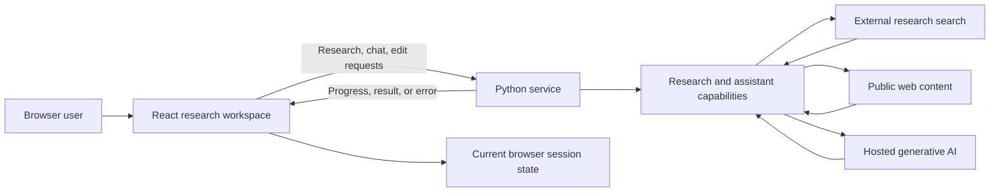
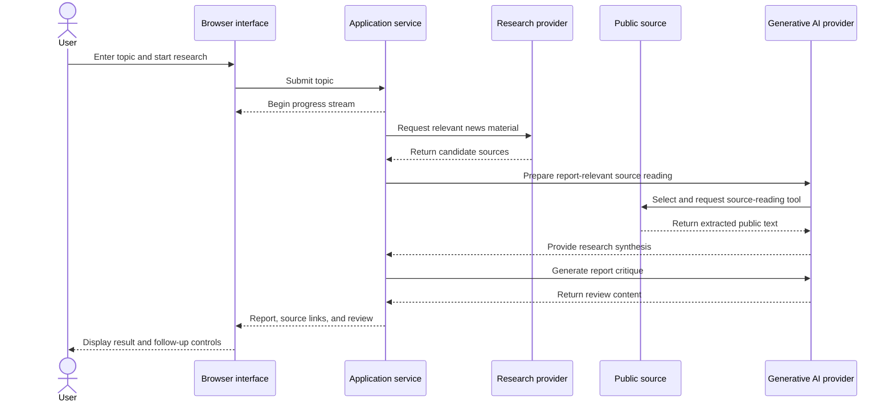
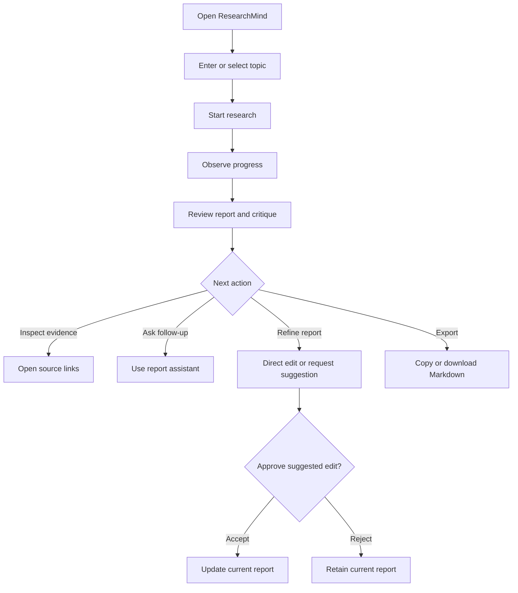
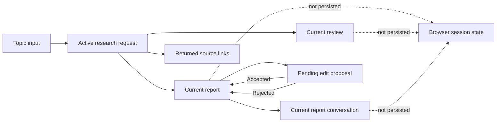

# ResearchMind

## Public Project Documentation

> **Public-disclosure scope:** This document explains the product, its verified capabilities, technical choices, and conceptual architecture for recruiters and technical reviewers. It does not publish source code, internal prompts, detailed decision rules, credentials, private service URLs, or low-level implementation instructions. This is a disclosure choice, not a guarantee of intellectual-property protection.

## Table of Contents

1. [Project Introduction](#1-project-introduction)
2. [Problem Statement and Industry Context](#2-problem-statement-and-industry-context)
3. [Project Vision and Objectives](#3-project-vision-and-objectives)
4. [Key Features and Functionalities](#4-key-features-and-functionalities)
5. [Technology Stack](#5-technology-stack)
6. [Technical Deep Dive](#6-technical-deep-dive)
7. [System Architecture](#7-system-architecture)
8. [Module-Wise Breakdown](#8-module-wise-breakdown)
9. [End-to-End Application Workflow](#9-end-to-end-application-workflow)
10. [Algorithms and Technical Methodology](#10-algorithms-and-technical-methodology)
11. [Database Architecture](#11-database-architecture)
12. [API Architecture](#12-api-architecture)
13. [User Interface and Screenshots](#13-user-interface-and-screenshots)
14. [Engineering Decisions and Design Choices](#14-engineering-decisions-and-design-choices)
15. [Performance, Testing, and Evaluation](#15-performance-testing-and-evaluation)
16. [Results and Achievements](#16-results-and-achievements)
17. [Technical Challenges and Solutions](#17-technical-challenges-and-solutions)
18. [Security and Scalability](#18-security-and-scalability)
19. [Limitations](#19-limitations)
20. [Future Roadmap](#20-future-roadmap)
21. [Developer Contributions and Technical Competencies](#21-developer-contributions-and-technical-competencies)
22. [Conclusion](#22-conclusion)
23. [References and Technical Resources](#23-references-and-technical-resources)

## 1. Project Introduction

### Project profile

| Item | Description |
|---|---|
| Project | ResearchMind |
| Tagline | Turn a research question into a source-linked first draft |
| Category | AI-assisted research productivity |
| Domain | Information discovery, research synthesis, and report preparation |
| Project stage | Working prototype |
| Organization identified in project metadata | Ultriti-Tech |
| Product release version | No shared product release version is defined |

ResearchMind is a browser-based workspace for exploring a topic and preparing an initial research report. The experience combines a structured report, source links, a separate review, and a report-focused assistant. Users can ask follow-up questions, edit the report, export it, or review suggested changes before deciding whether to apply them.

The project addresses a familiar early-research problem: information gathering, drafting, and feedback often happen across disconnected tools. ResearchMind brings those activities into one interface and keeps the user responsible for checking sources and making final decisions.

The product is relevant to students, analysts, product teams, writers, and other knowledge workers who need an initial orientation to a topic. It is not presented as an authoritative research source or as a replacement for expert analysis.

## 2. Problem Statement and Industry Context

### Industry challenge

Early-stage research requires a person to find relevant material, assess its usefulness, synthesize it into a coherent overview, and decide what needs deeper investigation. Switching between search results, reading, note-taking, drafting, and review can slow that process.

### Problems faced by target users

- Turning a broad question into an organized first draft takes time.
- Important sources can be separated from the notes or conclusions they informed.
- Drafting and critique often happen in different tools.
- Users may want to ask follow-up questions without losing the report context.
- AI-suggested revisions need a review step so that users retain control.

### Project response

ResearchMind provides a topic-to-report experience with visible progress, source links, a separate critique, and report-focused follow-up. It supports human review by making sources available and requiring explicit approval for assistant-proposed changes.

### Practical applications

| Audience | Example scenario | Expected benefit | Review required |
|---|---|---|---|
| Student or educator | Build an initial overview of a subject and find material for further reading | A structured starting point for exploration | Verify factual claims and source suitability |
| Research or market analyst | Prepare a first-pass overview of public reporting on a trend | Less effort spent organizing an initial brief | Compare with primary and licensed sources |
| Product or strategy team | Develop background material before a planning discussion | A shared draft to inform further investigation | Validate decision-critical information |
| Writer or communications team | Assemble a backgrounder before drafting a public-facing piece | A faster way to organize initial material | Editorial and factual review before publication |

These are realistic potential uses of the implemented features, not claims of customer deployment or measured business impact. The prototype is best suited to low-risk, human-reviewed research preparation.

## 3. Project Vision and Objectives

### Vision

Make the first stage of research more focused by bringing topic exploration, report review, and follow-up into one user-controlled workspace.

### Primary objectives

1. Accept a topic and produce an organized initial report.
2. Keep source links available for independent inspection.
3. Present critique separately from report content.
4. Support follow-up questions about the current report.
5. Let users edit, copy, or download report content.
6. Require user review before applying assistant-suggested changes.

### Secondary objectives

- Make progress visible during longer-running requests.
- Provide a responsive interface for report reading and assistant interaction.
- Communicate the limitations of generated research clearly.

### Technical goals

- Provide a browser UI built with a component-oriented frontend framework.
- Connect the UI to a typed Python service.
- Integrate hosted research and generative-AI capabilities.
- Stream progress updates to the user.
- Validate edit requests and handle proposed changes as reviewable content.

### Business goals and expected outcomes

The project explores how AI can reduce friction in preparing an initial research brief. The expected outcome is a draft that helps a user orient themselves and plan further research. No productivity improvement or business impact has been measured.

### Scope

**Implemented:** topic entry, progress display, report and review presentation, source links, report Q&A, direct editing, copy/download, and review-before-apply suggested edits.

**Outside the current scope:** user accounts, saved report history, database persistence, enterprise administration, formal quality evaluation, and production operations.

## 4. Key Features and Functionalities

### Feature status summary

| Status | Meaning |
|---|---|
| Implemented | Present in the inspected application code |
| Partial / constrained | Available with a limited scope or known constraint |
| Planned | Suggested future enhancement; not currently implemented |

### Implemented features

| Feature | What it does and why it matters | User interaction | High-level operation and output |
|---|---|---|---|
| Topic-based research | Starts an initial investigation from a user-selected topic | Enter a topic or select a suggestion, then start | Research capability gathers material and returns a report, feedback, and source links |
| Progress feedback | Shows that work is underway and which broad stage is active | Observe the progress label and bar | Progress events update the visible four-stage status |
| Structured research report | Presents an organized draft for further reading and editing | Read the report in the workspace | AI-assisted synthesis is displayed as Markdown and includes returned source links |
| Separate report review | Provides an assessment distinct from the report itself | Switch to the Review tab | Review content is displayed separately and may include a score, strengths, and improvement areas |
| Report question answering | Lets the user ask questions about the current report | Send a message in the report assistant | The supplied report and conversation provide context for an answer |
| Direct report editing | Lets the user modify report text in the report view | Edit the report and confirm the edit | Updated report text replaces the current browser-held value |
| Suggested report edits | Offers an AI-proposed revision without silently changing the report | Request a change, inspect the proposal, accept or reject | Proposed text changes and reasons are displayed for a user decision |
| Copy and Markdown download | Makes the report portable to other tools | Use Copy or Download | Copies report text or downloads a `.md` document |
| Home and About experiences | Supports research work and product discovery | Navigate using the header | Displays the research workspace or product overview |

### Partially implemented or constrained capabilities

| Capability | Current state |
|---|---|
| Source-backed research | Source URLs are included, but claim-by-claim attribution and automated source verification are not implemented |
| Research coverage | The current external search and page-reading behavior is bounded; it is not a comprehensive literature review |
| Report persistence | Current work is held in browser component state; there is no saved workspace or report history |
| Provider flexibility | A Groq client is configured in the code, but active product flows use Gemini; provider switching/fallback is not implemented |
| Security controls | Input validation and CORS are present, but there is no application identity or authorization layer |
| Testing | Frontend build/lint and selected browser checks have been run; an automated application test suite is not declared |

### Planned enhancements

Authentication, durable storage, automated tests, robust provider recovery, source-evidence mapping, model evaluation, and production deployment controls are future opportunities, not implemented product features.

## 5. Technology Stack

### Stack summary

| Category | Technology | Role in ResearchMind |
|---|---|---|
| Frontend | React 19, JavaScript/JSX | Interactive research workspace and local UI state |
| Frontend build | Vite 8 | Development server and production asset bundling |
| Routing | React Router 7 | Home and About page navigation |
| Styling | Tailwind CSS 4, custom CSS | Component styling, theme, responsive layout |
| Markdown | `react-markdown`, `remark-gfm`, `@tailwindcss/typography` | Report, review, and assistant message presentation |
| Backend language | Python 3.11+ | Service-side application and research coordination |
| Backend framework | FastAPI | HTTP request handling, validation integration, and streaming response |
| ASGI server | Uvicorn | Backend development/server runtime |
| Validation | Pydantic | Request schemas and constrained edit input |
| AI orchestration | LangChain and LangChain Core | Model adapters, prompt composition, agent/tool integration, output parsing |
| AI model integration | Google Gemini through `langchain-google-genai` | Active research writing, critique, Q&A, and edit proposal generation |
| Additional AI integration | Groq through `langchain-groq` | Client is configured but not used in active application flows |
| Research integration | Firecrawl Python SDK | External news search |
| Page extraction | Requests, Beautiful Soup 4, lxml | Retrieve and parse public webpage content |
| Progress communication | JSON over HTTP and Server-Sent Events | Request/response exchange and research progress events |
| Database/storage | None | No database or durable application storage is implemented |
| Deployment/infrastructure | No complete deployment definition found | A deployment target or production topology is not established by the repository |
| Development/quality tools | npm, ESLint, Vite, Python compileall | Dependency management, frontend lint/build, Python syntax compilation |

### Technology choices in context

| Technology | What it is | Why it fits this project | Interaction and advantages | Limitations |
|---|---|---|---|---|
| React | JavaScript UI library | Supports interactive report and chat views | Components manage distinct user-facing areas and their state | Current state is not persisted; no frontend test framework is declared |
| Vite | Frontend dev/build tool | Provides local development and asset bundling | Integrates the React and Tailwind plugins | Production hosting is not configured in the repository |
| Tailwind CSS | Utility-first CSS system | Enables quick styling of a dark, responsive interface | Used with CSS variables for project theme and layout | Utility-heavy component markup can be dense |
| FastAPI | Python web framework | Supports typed request handling and streamed responses | Connects browser features with service-side operations | Authentication and authorization are not implemented |
| Pydantic | Python data validation library | Provides request models and validation for edit inputs | Used with FastAPI routes to reject invalid structures and edit metadata | Validation does not establish identity, authorization, or content correctness |
| LangChain | LLM integration framework | Provides model abstractions, prompts, tools, agents, and parsers | Connects the configured Gemini model to the active AI features | Model/provider behavior remains external; library complexity is an added dependency |
| Google Gemini | Hosted generative model service | Supplies the active language-model capability | Called through LangChain for research content and report assistance | Requires credentials/network/provider availability; output may be inaccurate |
| Firecrawl | Hosted search/research service | Provides candidate news material without a project-owned search index | Search results feed the report workflow | Relevance and availability depend on an external provider |
| Requests / Beautiful Soup / lxml | Python HTTP and HTML parsing libraries | Support basic webpage text extraction | Retrieved pages are parsed into text for research use | Some pages block retrieval, require client-side rendering, or yield partial text |
| SSE | HTTP text-event streaming pattern | Supports visible progress for a long-running request | Service events are consumed by a browser Fetch reader | Current worker model is not a durable job queue and has no explicit cancellation |

### Database and storage

No database technology is used. Current report, review, conversation, and edit state live in the active frontend experience. There are no database tables, collections, migrations, or persistent relationships.

### Authentication and security

No identity provider, authentication framework, or role authorization is present. CORS is configured, and edit requests have input validation. These are not substitutes for user authentication or authorization.

### APIs and integrations

The application has internal frontend-to-service HTTP capabilities and external Firecrawl/Gemini integrations. Public documentation below describes API capabilities at a representative level; it omits environment values, private service URLs, prompts, and low-level schemas.

### Deployment and infrastructure

No complete container, infrastructure-as-code, CI deployment workflow, or production hosting definition was found. A configured frontend origin in CORS is not, by itself, evidence of a complete deployed environment.

## 6. Technical Deep Dive

### 6.1 Application architecture

ResearchMind separates browser presentation from service-side research and AI capabilities. The frontend is responsible for input, state presentation, report rendering, and user decisions. The service validates requests, coordinates the research capability, invokes configured providers, and returns results. The browser receives progress for research operations and retains the current working report.

This separation enables the UI and service to evolve independently, but the current repository does not establish a formal deployment topology or a durable job-processing architecture.

### 6.2 Frontend architecture

The React frontend includes:

- A shared navigation and route shell.
- A research workspace that owns topic, progress, errors, and current result state.
- A progress component that maps stage state into a visual indicator.
- A report component for report/review display and editing/export controls.
- An assistant component for report questions and edit proposal review.
- An About page that describes purpose, user benefits, intended audiences, and limitations.
- An API helper that isolates network requests and stream parsing from view components.

The UI uses component state rather than a global state library or persistence service. A key reset on the assistant component when the report topic changes starts a fresh assistant conversation for the newly generated topic.

### 6.3 Backend design

The Python service is organized around API routing, request schemas, research coordination, provider/model configuration, retrieval tools, and patch handling. FastAPI exposes the application functions; Pydantic supplies typed request validation. Research processing runs separately from the stream-producing request handler using a daemon thread and in-memory queue.

The modular organization makes responsibilities identifiable. However, the background work is tied to process memory and is not durable across service restarts; it also lacks job recovery and cancellation features.

### 6.4 AI model integration

The active model integration is Google Gemini using a model identifier configured in the source as `gemini-3.5-flash-lite`, with temperature set to zero. The model is used for report-related generation, critique, report Q&A, reading assistance, and structured edit proposals.

The code also initializes a Groq chat model, but no active user-facing request path was found that uses it. It is not currently a tested fallback or selectable model option.

The application delegates inference to a hosted provider. This avoids managing model weights and inference infrastructure in the repository, but makes core functionality dependent on provider credentials, availability, network conditions, service limits, and provider data policies.

### 6.5 Retrieval and content processing

The active research experience combines external news discovery with webpage text extraction. Search results are normalized into article metadata. A reader agent can select a relevant URL and call a webpage-reading tool. The current tool fetches the page, removes common non-content HTML regions, extracts text, and applies an output limit.

This is a lightweight retrieval-and-synthesis design, not a vector database, semantic search index, or persistent retrieval-augmented generation (RAG) system. No embedding model, vector store, or document index is present in the repository.

### 6.6 Agent orchestration and generation

LangChain constructs the reader agent and the writer and critic chains. The application coordinates search, reading, writing, and review in a sequential workflow. It also uses the model's structured-output capability for edit proposals.

The package list includes LangGraph, but the inspected active pipeline does not construct a LangGraph state graph. The public design should therefore be described as a sequential AI-assisted workflow rather than a graph-based multi-agent runtime.

Full system prompts and internal agent instructions are intentionally not included in this public document.

### 6.7 Asynchronous progress communication

The research operation returns a stream of status, result, or error events. A Python queue communicates events from the worker thread to the response stream. The browser reads the response body incrementally, buffers incomplete chunks, and parses complete events.

This allows the user to see progress without waiting for one final response. It is a request-scoped implementation, not a persistent message queue or distributed background-job service.

### 6.8 Data handling

Request data consists of a topic, report text, chat messages, or requested edit instructions. It is sent to the service and, for AI operations, to external providers. The app does not save generated reports or chat history in a database.

No database interactions, caching layer, or application-owned search index are implemented.

### 6.9 Error handling

- Research worker exceptions are surfaced as stream error events with stage context.
- Search configuration/provider failures are translated into HTTP exceptions.
- The webpage extraction tool returns readable error text for common request failures.
- Report Q&A rejects an empty conversation or one that does not end with a user message.
- Edit failures distinguish invalid patch/syntax cases from unexpected provider/generation errors.
- Frontend request helpers surface error details or status information to the UI.

Error recovery, retry policies, provider circuit breaking, and durable job recovery are not implemented.

## 7. System Architecture

### 7.1 High-level component view



### 7.2 Layer responsibilities

| Layer | Responsibility |
|---|---|
| Presentation | Topic input, status, report/review rendering, chat, editing, export, navigation |
| Service/API | Request validation, route handling, CORS configuration, streamed or JSON responses |
| Research capability | Coordinate retrieval, page reading, report generation, and critique |
| AI capability | Generate report content, critique, report answers, and proposed edits |
| External services | Supply search results, model inference, and public webpage content |
| Persistence | Not implemented; the current report and chat remain in frontend state |

### 7.3 Request lifecycle



The diagram is conceptual. It intentionally omits prompts, exact internal message formats, private service addresses, and detailed implementation logic.

### 7.4 External service integrations

- **Firecrawl:** news-oriented search.
- **Google Gemini:** active model provider for report and assistant capabilities.
- **Public websites:** source content may be retrieved for text extraction.
- **Groq:** configured in source but not used in active application flows.

## 8. Module-Wise Breakdown

| Module | Purpose and responsibilities | Input → output | Technologies | Related concepts |
|---|---|---|---|---|
| Application shell and navigation | Render shared navigation, page routes, and workspace layout | Route → page | React, React Router | Client-side routing, responsive UI |
| Research workspace | Collect topic, launch work, retain visible request/result state | Topic → progress/result/error | React, API helper | State management, asynchronous UI |
| Progress display | Show the current stage and completion | Stage statuses → progress bar/label | React | Progressive feedback |
| Report and review display | Render report and feedback; support direct edit and export | Report/feedback → Markdown UI or download | React Markdown, GFM, browser APIs | Content rendering, local editing |
| Report assistant | Handle report questions and edit mode; review changes | User message → answer/proposal | React, service API, Gemini integration | Contextual Q&A, human review |
| API client | Submit requests and interpret responses/streamed updates | UI state → HTTP request; stream → UI events | JavaScript Fetch | API integration, incremental parsing |
| API application | Route service requests, apply validation, configure CORS | HTTP request → JSON or event stream | FastAPI, Pydantic | Request/response API design |
| Research coordination | Run search, source reading, report generation, critique | Topic and provider results → report/review/sources | Python, LangChain, Firecrawl | Sequential orchestration |
| AI/model configuration | Configure model integrations and generation components | Prompt context → model output | LangChain, Gemini, Groq package | Hosted inference |
| Retrieval and extraction | Search external news and extract page text | Topic/URL → search metadata/text | Firecrawl, Requests, Beautiful Soup, lxml | External retrieval, HTML parsing |
| Edit proposal and application | Generate, validate, and return candidate text edits | Report/instruction → proposal and updated draft | Gemini structured output, Python text processing | Structured output, patch validation |
| Data schemas | Define request and result shapes | Incoming values → typed/validated data | Pydantic, Python typing | Input validation |

This module map describes responsibilities, not a complete source-code listing or reproducible implementation guide.

## 9. End-to-End Application Workflow

### 9.1 Application initialization

1. The browser loads the React application and shared navigation.
2. The router selects the Home or About experience.
3. The Home workspace initializes empty topic, progress, result, and assistant state.
4. The frontend reads the configured service base URL when requests are made.

### 9.2 Research request

1. The user enters a topic or chooses a suggestion.
2. The frontend starts a research request and clears prior result/error state.
3. The service begins the research operation and emits progress events.
4. The research capability retrieves candidate news material.
5. A reader capability can select and read relevant public material.
6. A report is generated and source links are included.
7. Separate review feedback is generated.
8. The service emits the final result; the frontend displays report and feedback.

### 9.3 Follow-up and edit workflow

1. A user asks a report-related question, or switches to edit mode.
2. The frontend submits the current report and relevant user message/instruction.
3. The assistant returns an answer or edit proposal.
4. A proposed edit is displayed for review.
5. The user accepts it to update current browser state or rejects it to retain the original.

### 9.4 Workflow diagram



### 9.5 Authentication and authorization flow

There is no authentication or authorization flow in the current implementation. Requests are not associated with an account, and the application has no per-user report ownership model.

## 10. Algorithms and Technical Methodology

### 10.1 Sequential research workflow

**Concept:** Divide research into ordered responsibilities: source discovery, deeper reading, synthesis, and critique.

**Project role:** Coordinates the user-submitted topic through a fixed sequence and returns a report with sources and separate feedback.

**Input/output:** Topic → search metadata, extracted content, report, critique, source links.

**Advantages:** Easy to follow, progress can map to visible stages, and each responsibility is identifiable.

**Limitations:** A failure in a stage can stop the run; no durable workflow engine or independent quality gate is present.

**Evaluation:** Stage success rates, completion time, source coverage, factual support, and reviewer usefulness could be evaluated in future work. No such measurements are available.

### 10.2 News search and source selection

**Concept:** Use an external search provider to discover candidate news items, then use an AI-assisted reader capability to choose a source for deeper inspection.

**Project role:** Provides current public material to the synthesis process.

**Advantages:** Leverages an external search service and preserves source URLs for the user.

**Limitations:** Search coverage is bounded; relevance and source quality are not independently evaluated. Only a selected source is used for deeper reading by the current reader workflow.

**Evaluation:** Recall of relevant sources, source diversity, freshness, and human-rated relevance would be appropriate. No evaluation dataset is included.

### 10.3 Page text extraction

**Concept:** Retrieve HTML, remove common non-content regions, and extract readable text.

**Project role:** Supplies page content to the research process.

**Advantages:** Simple and lightweight for pages whose content is present in returned HTML.

**Limitations:** JavaScript-rendered content, access restrictions, unusual layouts, and truncation can result in incomplete extraction.

**Evaluation:** Compare extracted content to source pages across representative site types; no extraction benchmark is present.

### 10.4 Language-model report synthesis

**Concept:** A hosted language model produces structured prose from the topic and retrieved material.

**Project role:** Creates an initial report with an introduction, findings, and conclusion; source links are appended from search metadata.

**Advantages:** Produces readable synthesis without hosting local model infrastructure.

**Limitations:** May omit information, introduce errors, or overstate evidence. Appended source links do not guarantee claim-level citation.

**Evaluation:** Human fact-checking, claim/source support review, coverage assessment, and rubric-based quality review are recommended. No formal evaluation has been conducted.

### 10.5 Critique generation

**Concept:** Use a separate model request to review the completed report and return a score, strengths, improvement areas, and verdict.

**Project role:** Supplies a distinct feedback view to help the user inspect the draft.

**Advantages:** Separates critique from report text and gives the user a second perspective.

**Limitations:** The critique is itself generated content and can be subjective or inaccurate; it is not an independent evaluator.

### 10.6 Report-grounded question answering

**Concept:** Provide the current report and conversation as context for a model response.

**Project role:** Lets the user ask follow-up questions about the report.

**Advantages:** Keeps exploration tied to the current document.

**Limitations:** The answer is grounded in supplied report text, which may itself be incomplete or wrong. No retrieval index or external evidence verification is used for Q&A.

### 10.7 Structured edit proposal

**Concept:** Ask the model for discrete suggested text changes instead of accepting an opaque whole-document replacement.

**Project role:** Displays a reviewable proposal and lets the user accept or reject it.

**Advantages:** Changes can be inspected before applying and malformed/ambiguous edits are rejected by the service.

**Limitations:** A proposed change may still be semantically incorrect; user review remains necessary.

### 10.8 Streaming progress

**Concept:** Deliver progress and final/error events over an HTTP response stream.

**Project role:** Keeps the user informed during research.

**Advantages:** Avoids a single silent long wait and fits the sequential progress display.

**Limitations:** The current implementation is request-scoped, uses in-memory coordination, and does not provide durable retries or cancellation.

### 10.9 No retrieval index or database algorithm

The project does not use embeddings, vector search, persistent document indexing, database query optimization, caching, or a recommendation algorithm. These must not be presented as implemented features.

## 11. Database Architecture

### Database selection

No database is selected or implemented. The repository has no database driver, schema, migration, ORM, table, or collection.

### Current storage strategy

| Information | Current handling |
|---|---|
| Topic | Frontend component state during the active session |
| Report and feedback | Frontend component state after result delivery |
| Chat messages | Assistant component state |
| Edit proposal | Assistant component state until accepted/rejected |
| Search metadata | Used during request processing; not saved as durable history |

### Data flow

User input is sent to the application service for processing. Generated report data and feedback return to the browser. The browser retains the active view state; no server-side persistence is performed.

### Conceptual data model

A persistent ER diagram is not applicable. The following conceptual state diagram is not a database schema:



### Future storage considerations

If persistence is added, the project should first define user ownership, retention, deletion, privacy expectations, provider data handling, and authorization. No database or schema recommendation is presented as an existing design.

## 12. API Architecture

### API categories

The service provides three user-facing capabilities: research with progress, report-focused conversation, and report edit proposals. They are called by the frontend and do not require application authentication in the current implementation.

| Method | Capability | Request concept | Response concept | Authentication |
|---|---|---|---|---|
| POST | Start topic research | Topic text | Progress stream followed by result or error | None implemented |
| POST | Ask about a report | Topic, report, and conversation messages | Answer text | None implemented |
| POST | Request a report edit | Current report text and edit instruction | Proposed changes, updated draft, or no-change result | None implemented |

Exact route paths and full schemas are intentionally omitted from this public showcase. They can be documented separately for authorized integration or maintenance needs.

### Communication patterns

- JSON request bodies are used for application actions.
- Research progress is returned as a text event stream containing status, result, or error data.
- Chat and edit operations return JSON.
- CORS allows configured frontend origins; CORS is not authentication.

### Representative conceptual example

```text
POST
Capability: Generate a report from a topic
Input:  { topic: "..." }
Output: Progress events, followed by report + review + source links
```

This is a conceptual example, not a complete public API contract. Error behavior includes FastAPI validation responses, an explicit invalid-conversation response for chat, edit validation errors, and streamed research errors.

## 13. User Interface and Screenshots

No genuine application screenshots were found in the repository. `frontend/src/assets/hero.png` is a design asset, not a UI capture. The references below are placeholders and must not be treated as screenshots.

### 13.1 Research workspace


| Field | Description |
|---|---|
| Screen | Home / Research workspace |
| Purpose | Start research and review the current report |
| Main components | Topic input, suggested topics, progress status, report/review view, assistant panel |
| Interactions | Start research, inspect report and review, ask questions, edit, copy/download, review suggested changes |
| Related features | Research request, report display, assistant, report export |

### 13.2 About page


| Field | Description |
|---|---|
| Screen | About ResearchMind |
| Purpose | Explain the product, objectives, intended users, technology overview, and limitations |
| Main components | Product overview, objective cards, audience cards, project profile, responsible-use note |
| Interactions | Read product overview and return to the workspace |
| Related features | Product discovery and user guidance |

### 13.3 Pending assistant edit


| Field | Description |
|---|---|
| Screen | Pending edit proposal within the research workspace |
| Purpose | Let the user inspect an AI-suggested change before applying it |
| Main components | Assistant conversation, old/new text comparison, accept and reject controls |
| Interactions | Review and accept/reject the proposed change |
| Related features | Report editing and user-controlled assistant workflow |

Capture genuine product screenshots and save them at the relative paths above to replace these placeholders. See [`screenshots/README.md`](./screenshots/README.md) for the expected filenames.

## 14. Engineering Decisions and Design Choices

| Decision | Evidence-based rationale | Trade-off / alternative |
|---|---|---|
| React component-based frontend | Interactive report, assistant, progress, and navigation areas can be composed as UI components | A server-rendered or native application could be used for other product requirements |
| Python service with FastAPI | Existing service uses typed request models, CORS middleware, HTTP routing, and streaming responses | A different backend framework could provide similar capabilities; no comparative benchmark is available |
| Hosted Gemini inference | Avoids managing model weights and local inference hardware | Introduces provider cost, network dependency, latency, and data-policy considerations |
| External search integration | Provides news-oriented discovery without maintaining a project-owned index | Search coverage and relevance depend on the provider |
| SSE for progress | Fits a one-way progress/result stream during a research request | Durable jobs or bidirectional interaction would need a separate job/event design |
| Separate report and review views | Keeps generated draft and critique distinguishable to users | Critique remains model-generated and requires human judgment |
| User approval for suggested edits | Preserves a human decision point before changing current report state | Requires an additional review action |
| No database in prototype | Keeps the current workflow focused and avoids defining persistence before ownership/retention requirements | No saved history, sharing, or cross-session continuity |
| Markdown report format | Readable in the app and portable through copy/download | Rich collaboration and document management are not provided |

No measured framework comparison, model comparison, or cost analysis is available in the repository.

## 15. Performance, Testing, and Evaluation

### Testing and checks performed

| Validation | Result in current project work | What it establishes |
|---|---|---|
| Frontend production build | Passed | Frontend bundles successfully in the checked environment |
| ESLint | Passed | No reported lint errors in the checked frontend |
| Python syntax compilation | Passed | Python files compile syntactically |
| Browser layout checks | Passed for selected pages/viewports | About-page scrolling and selected workspace responsive states rendered as expected |
| Live provider end-to-end research run | Not established | No successful external-service integration result is claimed |

No automated unit, API integration, end-to-end, or model evaluation suite is declared in the inspected project.

### Performance evidence

No request-latency, throughput, concurrency, memory, cost, or model-quality metrics are available. No performance graphs are included because measurements have not been made.

### Evaluation recommendations

- Measure end-to-end and per-stage response time with provider calls separately identified.
- Test external-service timeouts and error responses.
- Use a reviewed sample set to evaluate source relevance, coverage, factual support, and usefulness.
- Evaluate chat answers for grounding in the supplied report.
- Test patch proposals for safe behavior and user comprehension.
- Conduct accessibility and browser/device testing.
- Add unit tests for the text-edit validation and progress-event behaviors.

## 16. Results and Achievements

### Completed capabilities

- Topic-driven research workspace.
- Four-stage progress feedback.
- Report generation with source links.
- Separate critique/review view.
- Report-focused chat.
- Direct report editing, copy, and Markdown download.
- Suggested edits with user approval.
- Product About page and recruiter-oriented project materials.

### Demonstrated engineering capabilities

- Full-stack integration across React and Python.
- Typed request validation and error mapping.
- Hosted model and research-provider integration.
- Incremental progress delivery to a browser UI.
- Structured edit proposal presentation and approval.
- Responsive interface behavior and Markdown content rendering.

### Actual results

Build, lint, syntax compilation, and selected browser layout checks passed during development. The repository does not include verified impact metrics, production deployment results, model evaluation, or user-study findings. No unmeasured achievement is claimed.

## 17. Technical Challenges and Solutions

The following items are supported by the current implementation and validation history; they are not claims of measured production outcomes.

| Challenge | Evidence-based response | Outcome / lesson |
|---|---|---|
| Long research work needs visible feedback | Research status is emitted by stage and rendered as progress in the UI | The user can distinguish an active request from a finished result; a durable background-job system remains future work |
| Streamed data can arrive in incomplete chunks | Frontend buffers response chunks and processes complete event records | The current client can parse chunked progress responses; broader SSE compatibility testing is still needed |
| Generated edits should not be applied blindly | Edit proposals are displayed for acceptance/rejection; service validates target matching and overlaps | User retains approval control; semantic correctness still requires review |
| Report content must be readable in the browser and portable | Markdown rendering, direct editing, copy, and Markdown download are provided | The report can be reviewed and continued outside the app |
| Desktop workspace and longer informational pages have different scroll needs | Route-aware desktop layout constrains the research workspace while allowing About-page scrolling | Selected browser checks confirmed the About page scrolls and workspace remains viewport-sized |

The repository does not contain a formal development incident log; unrecorded challenges are not inferred.

## 18. Security and Scalability

### Implemented security-related measures

- Environment files are ignored by Git; secret values are not included in this document.
- CORS restricts browser access to a configured set of origins.
- Pydantic validates request structure.
- Edit requests limit content/instruction sizes, validate filenames, and restrict file extensions.
- Patch application rejects missing, ambiguous, and overlapping target changes.
- Unexpected edit-generation errors are logged and surfaced as a generic HTTP 502 message.

### Security controls not implemented

- Authentication, authorization, account ownership, and role-based access.
- Active rate limiting; the research limiter in source is commented out.
- Persistent data access policies, because no persistence layer exists.
- A visible URL allowlist for the model-selected webpage extraction destination.
- A formal privacy/retention or provider data-processing policy in repository documentation.

These gaps should be reviewed before exposing the service to untrusted or multi-user traffic. CORS is not an access-control substitute.

### Sensitive information handling

The source references API credentials through environment variables. This report does not include their values. Users should not put secrets or confidential source material into a public report or project README. Research/chat/edit content is sent to configured external providers when those capabilities are used; provider data-handling terms should be reviewed.

### Scalability considerations

The current request worker uses a daemon thread and in-memory queue. This is suitable only for a simple prototype scale; it is not a durable distributed job system. Potential future scaling work could introduce an independently managed job queue, cancellation and retry policies, provider concurrency controls, observability, and persistence after defining requirements.

No caching, horizontal scaling, load balancing, or database scaling mechanism is implemented or benchmarked.

## 19. Limitations

### Functional

- No user accounts, sharing, saved history, or collaborative editing.
- No persistent report storage.
- Report Q&A only receives the provided report and conversation; no separate retrieval index is present.
- Current search and source-reading behavior is bounded.

### AI/model

- Generated text and critique may contain errors or omissions.
- No claim-level source attribution or automated factuality check.
- No formal model benchmark or evaluation dataset.
- Groq integration is configured but not active in user-facing flows.

### Data and research coverage

- Search is limited to a small set of news results.
- Page extraction can be incomplete or fail depending on the target website.
- No dedicated proprietary dataset or corpus is included.

### Infrastructure and operations

- No complete deployment definition, monitoring, health-check, or CI deployment setup.
- No durable job processing, cancellation, or recovery mechanism.
- Backend dependency declarations are inconsistent between requirements and project metadata.

### Testing

- No automated unit/API/E2E test suite is declared.
- No successful live provider integration test is claimed.
- Selected UI checks do not constitute a cross-browser accessibility audit.

## 20. Future Roadmap

| Priority | Enhancement | Expected value |
|---|---|---|
| High | Add automated tests for research events, API validation, chat/edit flows, and patch behavior | Reduce regression risk |
| High | Add authentication and ownership before multi-user use | Protect user work and control access |
| High | Define privacy, retention, deletion, and provider data policies | Establish safe handling expectations |
| High | Improve source provenance and claim-to-source traceability | Make verification more efficient |
| Medium | Add provider timeouts, retry/backoff, cancellation, and durable jobs | Improve reliability for long-running requests |
| Medium | Evaluate source relevance, factuality, and answer grounding | Establish evidence-based quality expectations |
| Medium | Reconcile Python dependency manifests and document reproducible setup | Improve maintainability and onboarding |
| Medium | Add observability and deployment/health-check configuration | Support operational diagnosis |
| Medium | Implement/test model-provider selection only if the alternate path is intended | Make provider behavior explicit and dependable |
| Low | Add report organization and export options based on user feedback | Improve ongoing usability |
| Low | Capture real screenshots and accessibility evidence | Strengthen public portfolio presentation |

Priorities are recommendations for planning, not a committed delivery schedule.

## 21. Developer Contributions and Technical Competencies

The repository identifies Ultriti-Tech in backend package metadata but does not document individual contributor ownership. This section therefore describes the engineering work represented in the project, without attributing work to a named individual.

### Engineering areas represented

| Area | Work represented in the repository |
|---|---|
| Architecture and system design | Separation of browser experience, Python service, research integrations, model capabilities, and schemas |
| Frontend development | React pages/components, routing, responsive workspace, progress UI, Markdown report view |
| Backend development | FastAPI application, route composition, request schemas, research and assistant capabilities |
| AI/ML integration | LangChain model/provider integration, report synthesis, critique, report Q&A, structured edit suggestions |
| API engineering | JSON request/response capabilities and streamed research progress |
| Data handling | Normalized search-result metadata and in-memory current report/chat state; no database design is present |
| Validation and error handling | Pydantic edit validation, API error mapping, patch-target safety checks, visible frontend errors |
| Testing/debugging | Frontend build/lint, Python syntax compilation, selected browser layout checks |
| Deployment/infrastructure | No complete deployment or infrastructure implementation is established by the repository |

### Technical skills demonstrated

- React and modern JavaScript UI development.
- Responsive CSS and component-based design.
- Python service development with FastAPI and Pydantic.
- Integration of hosted LLM and search providers.
- Prompt/model orchestration concepts using LangChain.
- HTTP streaming and browser stream parsing.
- Markdown rendering and downloadable content generation.
- Structured edit proposals, input validation, and user approval patterns.
- Repository analysis, technical documentation, and honest limitation reporting.

## 22. Conclusion

ResearchMind demonstrates a full-stack AI-assisted research workflow: a user can submit a topic, receive progress, review a source-linked report and separate critique, ask report-related questions, and control suggested changes. The implementation combines a React/Vite frontend with a Python/FastAPI service and external research and generative-AI integrations.

Its technical contribution is a coherent prototype that joins research discovery, synthesis, review, and editing in one user experience. It also demonstrates a human-in-the-loop approach by keeping source inspection and approval of suggested edits with the user.

The project should be understood as a prototype. It does not provide persistence, user identity, formal model-quality evaluation, a complete automated test suite, or production operations. Continued work on evidence traceability, privacy, testing, security, and durable processing would be needed before higher-stakes or broader deployment.

## 23. References and Technical Resources

Official documentation for technologies present in the project:

1. [React](https://react.dev/learn)
2. [Vite](https://vite.dev/guide/)
3. [Tailwind CSS](https://tailwindcss.com/docs)
4. [React Router](https://reactrouter.com/start/library/installation)
5. [Python](https://docs.python.org/3/)
6. [FastAPI](https://fastapi.tiangolo.com/)
7. [Uvicorn](https://www.uvicorn.org/)
8. [Pydantic](https://docs.pydantic.dev/)
9. [LangChain](https://python.langchain.com/docs/introduction/)
10. [LangGraph](https://langchain-ai.github.io/langgraph/)
11. [Google Gemini API](https://ai.google.dev/gemini-api/docs)
12. [LangChain Google Generative AI integration](https://python.langchain.com/docs/integrations/chat/google_generative_ai/)
13. [LangChain Groq integration](https://python.langchain.com/docs/integrations/chat/groq/)
14. [Firecrawl](https://docs.firecrawl.dev/)
15. [Requests](https://requests.readthedocs.io/)
16. [Beautiful Soup](https://www.crummy.com/software/BeautifulSoup/bs4/doc/)
17. [lxml](https://lxml.de/)
18. [MDN: Server-Sent Events](https://developer.mozilla.org/en-US/docs/Web/API/Server-sent_events/Using_server-sent_events)
19. [React Markdown](https://github.com/remarkjs/react-markdown)
20. [remark-gfm](https://github.com/remarkjs/remark-gfm)
