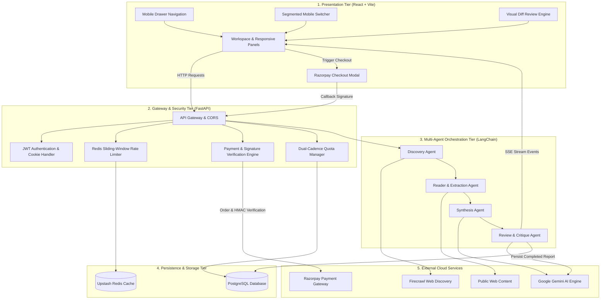
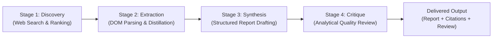
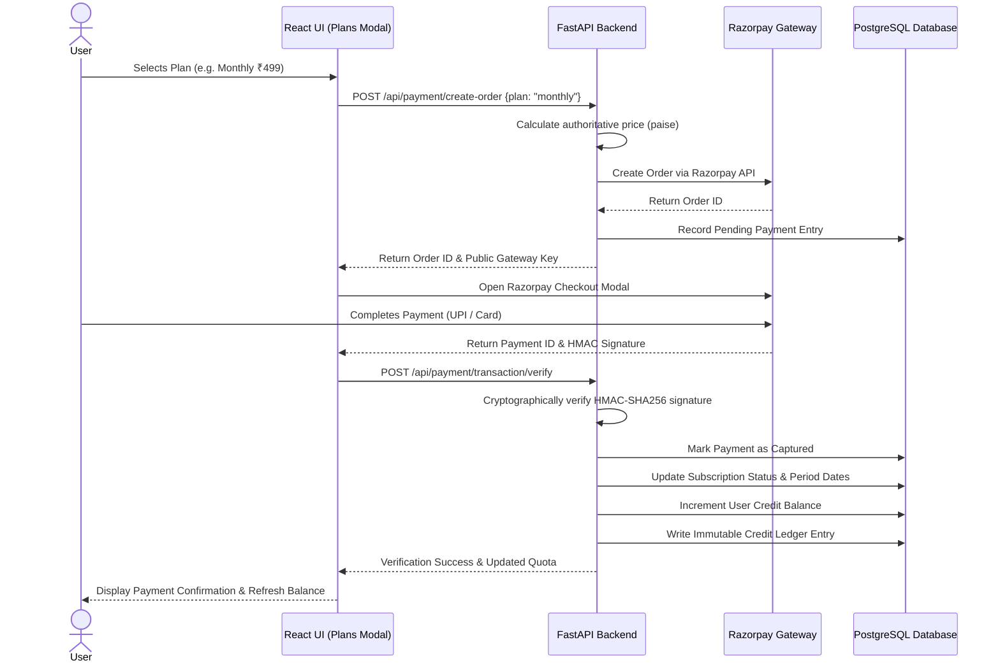
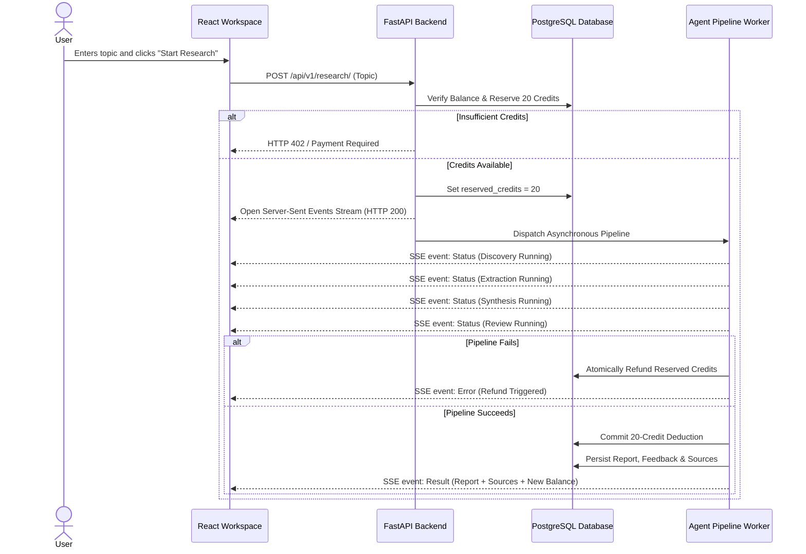

# ResearchMind – Multi-Agent AI Research Assistant

## 1. Project Overview

ResearchMind is an AI-powered research assistant designed to streamline the discovery, extraction, synthesis, and review of multi-source online information.

Traditional research workflows often require tedious context switching between search engines, multiple browser tabs, note-taking apps, and document editors. Conversely, relying on single-prompt generative AI often results in superficial responses, factual hallucinations, or unverified claims without clear provenance. 

ResearchMind addresses these challenges through a **multi-stage, multi-agent AI workflow** that transforms an open-ended research question into an authoritative, structured report backed by verifiable web citations. By separating retrieval, deep reading, synthesis, and critical review into specialized agents, the system delivers analytical depth, transparent citations, and a user-in-control document editing experience.

> **Public Disclosure & Intellectual Property Notice:**  
> This document provides an architectural and conceptual overview of ResearchMind for portfolio, recruitment, and technical review purposes. To protect proprietary design and prevent unauthorized replication, specific internal system prompts, heuristic weighting models, private API keys, and reproducible code blueprints are intentionally withheld.

### Target Audiences & Use Cases
- **Academic & Industry Researchers:** Rapidly survey emerging technologies, compile initial literature reviews, and organize primary sources.
- **Market & Business Analysts:** Generate industry briefs, competitive intelligence overviews, and summaries of recent market developments.
- **Product & Engineering Leaders:** Create background technical documentation and research briefs before architectural planning sessions.
- **Writers & Content Strategists:** Gather verified background facts, diverse perspectives, and reference links before drafting long-form publications.

---

## 2. Key Features

### 2.1 Multi-Agent Research Pipeline
- **Autonomous Query Discovery:** Deconstructs broad user topics into targeted search queries to identify relevant, up-to-date news and articles across the open web.
- **Distilled Content Extraction:** Selects high-signal candidate sources, fetches webpage content, and parses meaningful text while stripping scripts, styling, ads, and boilerplate navigation.
- **Structured Report Synthesis:** Organizes complex information into a comprehensive Markdown document with executive summaries, categorized findings, and formatted source citations.
- **Independent Analytical Critique:** Evaluates generated drafts using an independent critic agent that produces a quantitative score (out of 10), highlights strengths, and flags potential omissions or areas for deeper inquiry.

### 2.2 Interactive Document Assistant & Human-in-the-Loop Refinement
- **Grounded Document Q&A:** Allows users to query the generated report directly, with an assistant that grounds responses strictly within the established report context.
- **Structured Patch Proposals:** When requested to edit or expand a report, the assistant calculates discrete, localized text replacements rather than silently rewriting the entire document.
- **Visual Diff Verification:** Renders proposed modifications as clear before-and-after diffs with syntax highlighting, allowing users to inspect changes and explicitly **Accept** or **Reject** them before updating the document.

### 2.3 Tiered Quota Management & Payment Monetization
- **Flexible Subscription & Top-Up Tiers:** Supports Free tier usage, pay-as-you-go credit top-ups (₹50 for 50 credits), and recurring subscriptions (Monthly ₹499 for 600 credits; Yearly ₹4,999 for 800 credits/mo).
- **Dual-Cadence Quota Schedules:** Decouples daily free quota refreshes (resetting every midnight IST) from monthly subscription cycles to ensure purchased top-up credits are preserved across billing intervals.
- **Atomic Two-Phase Usage Safety:** Atomically reserves credits at the start of a research run, committing the deduction only upon successful report delivery and automatically refunding the reservation if a pipeline error occurs.
- **Cryptographic Payment Verification:** Integrates Razorpay checkout modals with server-side order generation and cryptographic HMAC-SHA256 signature verification to prevent client-side payment tampering.

### 2.4 Responsive, Mobile-First Workspace
- **Adaptive Screen Layouts:** Seamlessly transitions from a desktop multi-panel layout to a focused mobile workspace.
- **Sliding Navigation Drawer:** Provides a collapsible side navigation drawer on tablet and smartphone viewports (<768px).
- **Segmented Mobile Workspace Switcher:** Offers an intuitive mobile tab toggle (`📄 Report` vs `💬 AI Assistant` on <900px), eliminating horizontal scrolling and layout clutter.
- **Direct Export & Portability:** Supports instant clipboard copying and one-click raw Markdown (`.md`) downloads for seamless portability into external tools (Notion, Obsidian, Google Docs).

---

## 3. Technology Stack & Architectural Rationales

| Layer | Technologies | Architectural Rationale & Role |
|---|---|---|
| **Frontend Framework** | React 19, JavaScript (JSX) | Component-driven architecture supporting dynamic state changes across research progress, Markdown rendering, and interactive diff reviews. |
| **Build & Tooling** | Vite 8 | Near-instant Hot Module Replacement (HMR) and optimized Rollup-based production bundling. |
| **Styling & Icons** | Tailwind CSS 4, Lucide React | Utility-first responsive styling, CSS variables for dark-mode themes, and lightweight SVG iconography. |
| **Markdown Processing** | `react-markdown`, `remark-gfm`, `@tailwindcss/typography` | High-fidelity rendering of GitHub-Flavored Markdown tables, blockquotes, and prose elements. |
| **Backend Framework** | Python 3.11+, FastAPI, Uvicorn | Asynchronous ASGI framework providing native concurrency, automatic OpenAPI schemas, and high-throughput streaming. |
| **Data Validation** | Pydantic, `pydantic-settings` | Runtime type enforcement, strict request payload validation, and typed environment configuration. |
| **AI Orchestration** | LangChain, LangChain Core | Standardized abstractions for chat models, structured output generation, prompt templates, and agent tool bindings. |
| **Language Models** | Google Gemini, Groq-hosted models | High-speed semantic synthesis, analytical critique generation, and structured patch diffing. |
| **Web Research** | Firecrawl API & Web Extraction Utilities | Real-time web discovery, article metadata retrieval, and clean HTML content extraction. |
| **Payment Gateway** | Razorpay SDK & Checkout (`checkout.js`) | Indian & international payment processing (UPI, Cards, NetBanking) with cryptographic HMAC-SHA256 verification. |
| **Relational Database** | PostgreSQL, SQLAlchemy | ACID-compliant relational persistence for user accounts, research history, payment logs, subscriptions, and credit ledgers. |
| **Distributed Caching** | Upstash Redis | Low-latency in-memory sliding-window counters for IP- and account-based rate limiting. |
| **Communication Protocols** | REST APIs, Server-Sent Events (SSE) | Standardized JSON for synchronous actions and unidirectional HTTP text-event streams for real-time pipeline progress updates. |

---

## 4. High-Level System Architecture

ResearchMind is structured around a multi-tier client-server architecture designed for high availability, separation of concerns, and clear data lineage:

### Architectural Tier Descriptions
1. **Presentation Tier:** Executes in the user's browser, managing view state, responsive transitions, real-time SSE stream consumption, and interactive diff approval.
2. **Gateway & Security Tier:** Handles identity validation, token issuance, rate limiting, credit reservation/refund lifecycle, and cryptographic payment verification.
3. **Multi-Agent Orchestration Tier:** Manages sequential agent handoffs, context-window constraints, tool execution, and prompt chaining.
4. **Persistence Tier:** Guarantees ACID transactional durability across user profiles, credit movements, subscription validity, and saved research syntheses.
5. **External Services Tier:** Integrates third-party APIs for live web indexing, payment settlement, and generative model inference.

---

## 5. Multi-Stage AI Research Workflow

Rather than attempting to produce research in a single monolithic prompt, ResearchMind breaks the problem into four focused stages where each agent performs a specific task:

### Stage 1: Research Discovery
- **Input:** User-submitted topic or research inquiry.
- **Process:** The Discovery Agent formats the topic into targeted search queries, interfaces with web search APIs, and retrieves candidate articles.
- **Output:** Normalized list of candidate sources with titles, destination URLs, publication dates, and preliminary relevance snippets.

### Stage 2: Content Extraction & Distillation
- **Input:** Candidate source URLs and topic context.
- **Process:** The Reader Agent selects the most promising sources, retrieves the public HTML, strips non-content DOM nodes (scripts, navigation, footer, styling), and extracts readable text.
- **Constraint Management:** Content is bounded to prevent token exhaustion, passing only dense, relevant textual evidence forward.

### Stage 3: Report Synthesis & Attribution
- **Input:** Query topic, source metadata, and extracted page contents.
- **Process:** The Synthesis Agent constructs a structured Markdown report. It produces an executive introduction, multiple categorized analytical sections, and a synthesis conclusion.
- **Attribution:** The system attaches an explicit source citation list linking back to original public URLs.

### Stage 4: Independent Analytical Review
- **Input:** Completed draft report and original topic.
- **Process:** The Critic Agent independently evaluates the draft against criteria including analytical clarity, depth, factual grounding, and structure.
- **Output:** Quantitative score (out of 10), bulleted strengths, potential blind spots or limitations, and an overall verdict.

---

## 6. End-to-End Data & Transactional Lifecycle

### 6.1 Payment & Subscription Verification Flow

### 6.2 Research Request & Credit Reservation Lifecycle

---

## 7. Engineering Concepts Demonstrated

1. **Multi-Agent Orchestration & Task Specialization:** Demonstrates decomposing complex generative tasks into decoupled, single-responsibility agents with clean data handoffs.
2. **Two-Phase Resource Reservation Pattern:** Protects user balances against credit loss during downstream AI/network failures by reserving quota upfront, committing on success, and refunding on error.
3. **Cryptographic Integrity & Server-Authoritative Billing:** Guarantees financial security by enforcing plan pricing strictly on the backend and validating payment authenticity using HMAC-SHA256 cryptographic signatures.
4. **Dual-Cadence Quota Resets:** Implements timezone-aware (Asia/Kolkata) calendar resets for free daily quotas while preserving purchased top-up credits across monthly subscription rollovers.
5. **Real-Time Asynchronous Progress Streaming:** Implements unidirectional Server-Sent Events (SSE) to provide continuous user feedback during multi-step background operations without polling overhead.
6. **Human-in-the-Loop (HITL) Revision Verification:** Enforces a review-before-commit policy for AI-suggested document revisions, rendering unified diffs and requiring explicit user authorization.
7. **Defensive API Engineering:** Utilizes strict Pydantic validation, IP- and account-based rate limiting via Redis, and secure JWT authentication.
8. **Mobile-First Responsive UI Engineering:** Employs CSS container-level boundaries, flexbox shrink-protection, sliding drawers, and segmented view toggles to provide a seamless mobile experience.

---

## 8. Architectural Design Considerations & Trade-Offs

| Decision | Alternative Considered | Selected Rationale |
|---|---|---|
| **Server-Sent Events (SSE)** | WebSockets | Research pipeline progress is strictly unidirectional (server $\rightarrow$ client). SSE operates over standard HTTP, natively traverses firewalls, supports automatic reconnection, and requires less operational complexity than full-duplex WebSockets. |
| **Multi-Agent Pipeline** | Single Monolithic Prompt | A single LLM call attempting search, reading, writing, and review often hallucinates sources, suffers from attention drift, and provides zero visibility into intermediate progress. Multi-agent staging provides granular progress reporting and higher analytical rigor. |
| **Localized Patch Diffing** | Full Document Overwrite | Silent full-document rewrites can erase user edits or introduce subtle semantic corruption. Calculating localized diffs preserves user edits and keeps the human in control. |
| **Server-Side Pricing** | Client-Supplied Amounts | Trusting client-side amounts enables price tampering. Calculating prices strictly on the server using predefined SKUs ensures financial integrity. |
| **Relational Credit Ledger** | Single Integer Balance Counter | Single counters provide no auditability. An immutable `credit_transactions` ledger provides double-entry style tracking for audits, usage trends, and refund verification. |

---

## 9. Security & Data Protection Architecture

- **Server-Authoritative Validation:** Plan pricing, credit costs, and quota updates are strictly executed server-side. No client-supplied financial amount is ever trusted.
- **Cryptographic Signature Verification:** Razorpay payment webhooks and callbacks are validated against cryptographic HMAC-SHA256 digests.
- **Identity & Session Security:** Authentication utilizes JSON Web Tokens (JWT) transmitted via secure, HttpOnly cookies and standard `Authorization: Bearer` headers.
- **Distributed Rate Limiting:** Protected routes are guarded by Upstash Redis sliding-window limiters to mitigate denial-of-service (DoS) attempts and credential stuffing.
- **Content Boundary Enforcement:** Report inputs, code patches, and user instructions are validated against strict length and size limits to prevent buffer and memory exhaustion.
- **Tenant Data Isolation:** Research history and report records are strictly scoped to the authenticated owner's primary key; cross-tenant data access is blocked at the database query level.

---

## 10. Current Limitations

As an evolving prototype, ResearchMind currently operates with the following technical boundaries:

- **Bounded Source Scrape Depth:** Web extraction limits text length per source to maintain sub-minute pipeline latency and prevent context-window overflow.
- **Document-Level Attribution:** Sources are listed as overall citations; granular, claim-by-claim inline footnote citations are slated for future releases.
- **Transient Chat State:** Saved research reports are durably stored in PostgreSQL, but active follow-up chat sessions remain in client memory across page refreshes.
- **Asynchronous Webhook Queues:** Payment verification currently relies on synchronous client callbacks; asynchronous webhook retry queues (e.g. Celery / BullMQ) are planned for high-concurrency production deployments.
- **Evaluative Benchmarks:** Quality critique is currently performed by an independent LLM critic agent rather than an automated empirical benchmark dataset.

---

## 11. Future Scope & Roadmap

- **Graph-Based Agent Orchestration:** Migrating sequential pipelines to state-graph workflows (LangGraph) with dynamic branching, iterative query refinement, and fallback search loops.
- **Inline Claim Verification:** Implementing sentence-level citation mapping that links specific report sentences to verbatim excerpts from retrieved source documents.
- **Persistent Multi-Session Threads:** Storing conversational follow-up threads and document revision histories in durable relational tables.
- **Background Webhook Ingestion & Reconciliation:** Adding resilient worker queues for handling Razorpay webhook retries during intermittent network disconnects.
- **Enterprise Team Workspaces:** Introducing organization accounts, role-based access control (RBAC), shared research repositories, and team credit pools.
- **Multi-Format Export Integrations:** Providing native exports to PDF, DOCX, Google Docs, and Notion.

---

## 12. Project Summary

The core objective of ResearchMind is to explore how specialized, autonomous AI agents can collaborate to automate the multi-step research and synthesis process while preserving human oversight, citation transparency, and a clean, maintainable software architecture.

---

**Project Category:** Generative AI | Agentic AI | Full-Stack Development  
**Status:** Evolving Project
