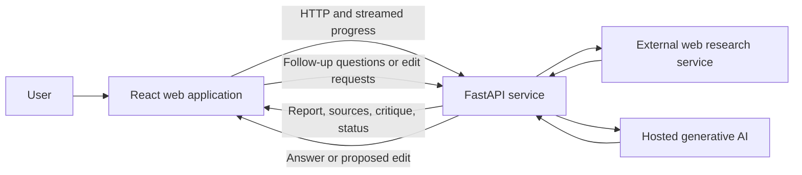

# ResearchMind

**Turn a research question into a source-linked first draft.**

ResearchMind is an AI-assisted research workspace that helps users explore a topic, review an organized draft with source links, and ask follow-up questions in one interface. It is a working prototype for human-reviewed research preparation—not an authoritative source or a substitute for expert judgment.

> **Preview:** No genuine application screenshots were present in the repository when this README was prepared. See [screenshots/README.md](./screenshots/README.md) for capture instructions; no placeholder is presented as an actual screenshot.

## Table of contents

- [Project overview](#project-overview)
- [Features](#features)
- [Application preview](#application-preview)
- [Architecture](#architecture)
- [Technology stack](#technology-stack)
- [Repository structure](#repository-structure)
- [Getting started](#getting-started)
- [Environment configuration](#environment-configuration)
- [Using the application](#using-the-application)
- [API overview](#api-overview)
- [Engineering notes](#engineering-notes)
- [Validation, limitations, and roadmap](#validation-limitations-and-roadmap)
- [Documentation](#documentation)
- [Contributing](#contributing)
- [License](#license)
- [Author](#author)

## Project overview

Early-stage research can involve moving between discovery, note-taking, drafting, and review tools. ResearchMind brings those activities into a browser-based workspace: a user submits a topic, follows progress as a report is prepared, inspects source links and a separate critique, and can continue with report-focused questions or edits.

The project is intended for students, analysts, writers, product teams, and other knowledge workers who need an initial orientation to a topic. Users should independently verify generated claims and sources, especially before relying on them for consequential decisions or publication.

## Features

### Implemented

- **Topic-based research:** Submit a topic and receive a structured initial report.
- **Visible progress:** Follow status updates while a report is being prepared.
- **Source links and review:** Inspect returned sources and a critique alongside the report.
- **Report-focused assistant:** Ask follow-up questions in the context of the current report.
- **User-controlled edits:** Request report changes and review proposed edits before applying them.
- **Export and editing controls:** Copy, download, and directly edit report content.
- **Responsive workspace:** Use the report and assistant layout across supported screen sizes.

### Not implemented / not claimed

- User accounts, role-based access, or saved report history.
- Database-backed persistence or enterprise administration.
- Formal model-quality evaluation or measured productivity outcomes.
- Production-grade operational guarantees.

## Application preview

No application screenshots are currently available. Add genuine captures at the paths below to show the product; until then these remain capture instructions, not images.

| Screen to capture | Suggested path | What it should show |
|---|---|---|
| Research workspace | `screenshots/research-workspace.png` | Topic entry and a generated report with source links |
| About page | `screenshots/about-page.png` | Product purpose and the research workflow |
| Assistant edit review | `screenshots/assistant-edit-review.png` | A proposed change awaiting user review |

See [screenshots/README.md](./screenshots/README.md).

## Architecture

The browser UI communicates with a FastAPI service. The service coordinates topic research and generative-AI capabilities through external providers and returns report content, source links, and progress updates. The frontend displays those results and supports report-focused follow-up and user-reviewed edits.



This is a high-level product view, not a complete internal design specification. The current project does not use a database for durable report storage.

## Technology stack

| Category | Technology | Purpose |
|---|---|---|
| Frontend | React 19, React DOM | Component-based browser interface |
| Frontend tooling | Vite 8 | Local development and frontend builds |
| Styling | Tailwind CSS 4 and project CSS | Layout and presentation |
| Backend | Python, FastAPI, Uvicorn | HTTP service and local ASGI server |
| Validation | Pydantic | Request and data validation |
| AI orchestration | LangChain, LangGraph | Integrating model and research workflows |
| Generative AI | Google Gemini through `langchain-google-genai` | Report and report-assistant functionality |
| Web research | Firecrawl through `firecrawl-py` | External research/search capability |
| Other configured integration | Groq through `langchain-groq` | Dependency is present; no active product flow was verified using it |
| Persistence | None | Reports are not stored in a project database |
| Development tools | npm, ESLint, Python, pip | Frontend dependency management, linting, and backend setup |

## Repository structure

```text
.
├── backend/
│   ├── main.py
│   ├── requirements.txt
│   └── src/
│       ├── api/          # HTTP routes
│       ├── dependencies/ # Research and assistant integrations
│       └── schema/       # Request and response models
├── frontend/
│   ├── package.json
│   └── src/
│       ├── api/          # Frontend API integration
│       ├── Components/   # Shared UI
│       └── Pages/        # Application pages
├── screenshots/          # Instructions for adding real captures
├── PROJECT_REPORT.md
└── PUBLIC_PROJECT_DOCUMENTATION.md
```

## Getting started

### Prerequisites

- Python 3.11 or newer.
- Node.js and npm compatible with the versions required by the frontend lockfile.
- API credentials for the external services used by the flows you want to run.

### 1. Clone the repository

```powershell
git clone https://github.com/Ultriti-Tech/reserach0banf.git
Set-Location reserach0banf
```

### 2. Configure and start the backend

From the repository root in PowerShell:

```powershell
py -3.11 -m venv backend\.venv
.\backend\.venv\Scripts\Activate.ps1
Set-Location backend
python -m pip install -r requirements.txt
uvicorn main:app --reload
```

The backend runs at `http://127.0.0.1:8000` by default. Keep this terminal open.

### 3. Configure and start the frontend

Open a second terminal at the repository root:

```powershell
Set-Location frontend
npm ci
```

Create `frontend\.env.local` with:

```dotenv
VITE_BASE_URL=http://127.0.0.1:8000
```

Then start the development server:

```powershell
npm run dev
```

Open the URL printed by Vite (typically `http://localhost:5173`). The backend permits the local Vite origin by default.

## Environment configuration

There is no checked-in `.env.example`. Create a local `backend\.env` file and supply credentials for the integrations you use:

```dotenv
GOOGLE_API_KEY=your_google_api_key
FIRECRAWL_API_KEY=your_firecrawl_api_key

# Optional frontend origins for deployments; not needed for the default local setup.
FRONTEND_URL=
FRONTEND_URL_2=
```

`GROQ_API_KEY` is referenced by the repository's configured Groq client, but an active user-facing flow using that client was not verified. Do not add real credentials to source control. The frontend's `VITE_BASE_URL` belongs in `frontend\.env.local` as shown above.

## Using the application

1. Start the backend and frontend using the setup steps.
2. Open the Vite development URL in a browser.
3. Enter a research topic and submit it.
4. Review the report, progress/result content, critique, and source links.
5. Ask a follow-up question or request an edit from the assistant.
6. Review suggested edits before choosing whether to apply them; verify report claims against the cited material.

## API overview

These are the verified application routes mounted under `/api/v1`. They do not require authentication in the current implementation.

| Method | Endpoint | Purpose |
|---|---|---|
| `POST` | `/api/v1/research/` | Start topic research and stream progress and final results using Server-Sent Events. |
| `POST` | `/api/v1/chatagent/` | Ask a report-focused follow-up question; returns a JSON answer. This route is excluded from the generated OpenAPI schema. |
| `POST` | `/api/v1/chatagent/editchat` | Request a report edit and receive a proposed change for user review. |

Request schemas and implementation details are documented in [PROJECT_REPORT.md](./PROJECT_REPORT.md).

## Engineering notes

- **Human review is part of the workflow:** source links are available for inspection, and assistant-proposed changes are reviewable before use.
- **Progressive feedback:** the research request provides streamed progress/results rather than requiring users to wait without status.
- **Typed service boundary:** FastAPI and Pydantic are used for HTTP routing and request validation.
- **No durable storage:** reports are not persisted to a project database or user account.
- **Security scope:** the current API has no authentication or authorization layer. Do not treat it as suitable for sensitive data or unrestricted public deployment without additional security and operational work.

## Validation, limitations, and roadmap

### Validation status

Frontend build and lint checks and backend Python compilation were run during development of the application. No automated test suite, API test report, model evaluation, or benchmark results were verified for this repository. These checks do not establish production readiness or guarantee research accuracy.

### Current limitations

- Generated research and answers may be incomplete or incorrect; users must validate sources and claims.
- No authentication, user accounts, or durable report history.
- External integrations require valid configuration and network access.
- The repository does not specify a project license.
- No genuine product screenshots or measured performance results are currently included.

### Potential next steps

- Add automated unit, API, and browser-level tests.
- Add authentication, rate limiting, and operational safeguards before public deployment.
- Introduce persistence only with a defined privacy and retention policy.
- Add evaluation procedures for source quality and report reliability.
- Capture and maintain genuine screenshots and document supported deployment configurations.

These are possible improvements, not features currently claimed as implemented.

## Documentation

- [Detailed technical project report](./PROJECT_REPORT.md)
- [Public project documentation](./PUBLIC_PROJECT_DOCUMENTATION.md)
- [Screenshot capture instructions](./screenshots/README.md)

## Contributing

The repository does not currently include a contribution guide or a formal contribution policy. For a proposed change, open an issue or pull request in the repository and describe the motivation, scope, and validation performed; maintainers can confirm whether it fits the project's direction.

## License

No `LICENSE` file or license declaration was found in the repository. All rights remain with their respective owners; do not assume permission to reuse, modify, or redistribute this project.

## Author

Repository organization: [Ultriti-Tech](https://github.com/Ultriti-Tech). No individual author profile or contact link was verified in the project metadata.
